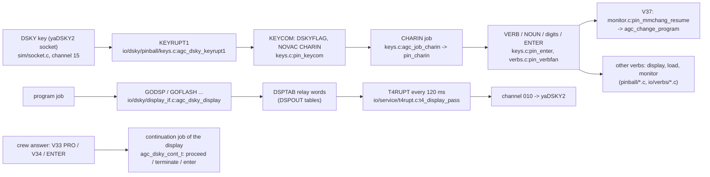
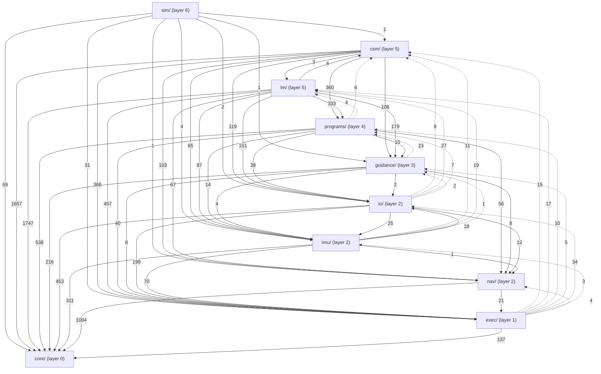
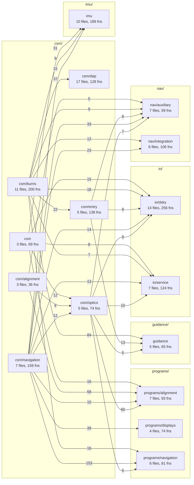
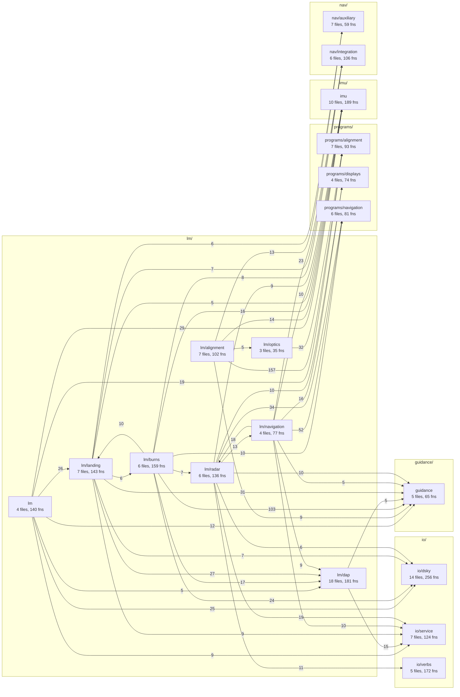
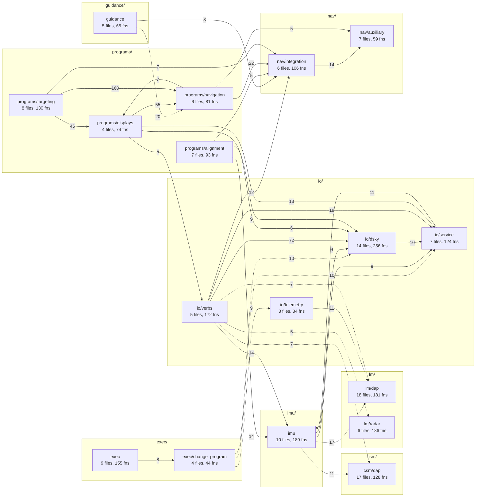

# System overview

How the C translation of the Apollo 11 flight software is put together:
the two programs it models, how work is scheduled, how time and
interrupts reach it, where its state lives, how the crew talks to it,
and how a program (Pxx) starts, runs, displays and ends. Every claim
names the C function that implements it (`file:function`), so it can be
checked against the code; the AGC label and listing page are in that
function's prolog.

Companion documents:

* [flowcharts/](flowcharts/) -- Mermaid flowcharts of the scheduler
  paths and the major program sequences, drawn from the C control flow.
* [xref.md](xref.md) -- generated index AGC label -> C function ->
  file:line (`python3 -I tools/xref.py`).
* [../TIPS.md](../TIPS.md) -- what the translation taught, by topic.
* [../modules/](../modules/) -- one note per lane; each translation lane
  has a "Program flow and decisions" section (flags tested, alarms,
  branches, data with scale, AGC labels -> C functions).
* The module map at the end of this page is generated from the compiler's
  call graph (`python3 -I tools/depgraph.py`).

## 1. Two vehicles, one library

The source of truth is two AGC ropes: **Comanche 055** (Colossus 2A, the
Command Module Computer) and **Luminary 099** (Luminary 1A, the Lunar
Module Guidance Computer). They share about 45 log sections (the
executive, waitlist, interpreter, conics, integration, pinball, alignment
...). The C tree keeps one library, `libagc.a`, that holds both:

* code common to both ropes lives once, in `src/core`, `src/exec`,
  `src/io`, `src/imu`, `src/nav`, `src/guidance`, `src/programs`;
* code only one rope has lives in `src/csm/` or `src/lm/`;
* small differences inside shared code are a test of
  `agc_state_vehicle()` (core/state.c), set once at power-on by
  `agc_power_on(v)` (exec/change_program/idle.c) from the rope the sim
  harness loaded (sim/main.c:resolve_vehicle).

Jobs and tasks are not function pointers (Power of Ten rule 9). Every
job or task is an enum id (`AGC_JOB_*`, `AGC_TASK_*`, 758 job and 165
task rows in `tools/registry.tsv`), and `src/exec/dispatch.c`
(generated by `tools/gen_registry.py`) is four flat `switch`es -- CSM
jobs, CSM tasks, LM jobs, LM tasks -- that call the handler of the
selected vehicle (`agc_dispatch_job`, `agc_dispatch_task`). This is the
C form of the AGC's 2CADR tables, and the reason the call graph stays
static and recursion-free.

## 2. The executive and the waitlist

The AGC is a cooperative multitasking machine with two schedulers: the
**executive** for jobs (long computations, priority ordered) and the
**waitlist** for tasks (short, time-triggered, run inside the T3
interrupt). Both are modelled word for word where the order of events
depends on them.

### Executive (src/exec/executive.c)

* A job is created by `agc_exec_novac` (NOVAC, no VAC area) or
  `agc_exec_findvac` (FINDVAC, claims one of five VAC areas). Both find
  the first free **core set** (7 on the CSM, 8 on the LM,
  `agc_exec_core_sets`) in `novac2`; none free is BAILOUT 1202, no VAC
  area is BAILOUT 1201 (`agc_bailout`, exec/alarm.c).
* `NEWJOB` says what runs next: -0 idle (DUMMYJOB), +0 keep core set 0,
  +k change to core set k. `setloc_compare` sets it when a new job's
  priority word beats the running one.
* `agc_exec_run_one` is ADVAN/NUDIRECT: if NEWJOB > 0 it swaps core set 0
  with core set NEWJOB (`chanjob` = CHANJOB, the **pre-emption point**),
  dispatches the job in core set 0, and afterwards does what the job's
  exit did in the AGC: ENDOFJOB (`end_of_job` frees the core set and VAC
  area, `ejscan_change` finds the next job or idles), JOBSLEEP (the job
  called `agc_exec_job_sleep` and stays in its core set), or CHANG1
  (`agc_exec_job_yield`: the job stays active with a new LOC and is
  swapped out if NEWJOB is set).
* A C job is a function `agc_job_<name>(agc_job_ctx_t *ctx)` that runs to
  completion or to a sleep/yield point. An AGC job that waited for an
  event (a DSKY answer, an IMU pulse train, an integration) is split into
  one function per resumption point; the continuation id is passed to the
  waiting primitive. What is lost: pre-emption in the middle of a job
  body (the AGC could switch at any interpreter instruction).
  Flowchart: [flowcharts/job-preemption.md](flowcharts/job-preemption.md).

### Waitlist (src/exec/waitlist.c)

* `agc_waitlist_call` (WAITLIST/TWIDDLE), `agc_waitlist_vardelay`,
  `agc_waitlist_fixdelay`, `agc_waitlist_longcall` (LONGCALL for delays
  over 162.5 s) insert a task into the AGC's own delta-time lists
  (`wait2`, `wtlst4`): TIME3 counts to the first task, LST1 holds the
  deltas between the next eight, LST2 the task ids. Nine tasks maximum:
  the tenth is BAILOUT 1203; a zero delay is POODOO 1204.
* TIME3 overflow is T3RUPT: `agc_waitlist_t3rupt` dispatches task 1,
  shifts both lists up, reloads TIME3 and repeats while the next task is
  due in the same centisecond (RUPTAGN). An empty slot runs ENDTASK
  (`agc_task_endtask` -> `svct3`: IMU drift compensation every 81.93 s
  when DRIFTFLG is set).
  Flowchart: [flowcharts/waitlist-tick.md](flowcharts/waitlist-tick.md).

## 3. Interrupts and the clock

The C library has no clock of its own. The sim harness (`src/sim`, not
part of `libagc.a`) is the hardware: `sim_clock_tick` (sim/clock.c) is
one centisecond of AGC time, 32 counts of the 3200 Hz scaler, each count
running `clock_step`:

* `clock_counters` advances the counter-timers as yaAGC does: TIME1/TIME2
  (`agc_time_advance_cs`) and TIME3 (`agc_waitlist_tick`) at the TIME1
  phase, TIME5 and TIME4 at their phases (`time_pinc`), TIME6 at every
  odd count while channel 13 bit 15 enables it (`time6_dinc`, 1/1600 s);
  an overflow requests the interrupt;
* `clock_rupts` takes the pending interrupts in vector order (T6, T5, T3,
  T4, KEYRUPT1, KEYRUPT2/MARKRUPT, UPRUPT, DOWNRUPT, RADARUPT, HANDRUPT),
  each through its lead-in in `src/exec/interrupts.c` (`agc_rupt_t6`,
  `agc_rupt_t5`, `agc_rupt_t3`, ...), never while INHINT is in force;
* `clock_exec` runs the executive (`agc_exec_run_one`) until it is idle,
  after any count that took an interrupt and at the end of the
  centisecond.

Each lead-in inhibits interrupts, calls the handler and leaves through
`rupt_exit`, which runs any software restart the handler requested.
Handlers owned by other subsystems are reached through
`agc_dispatch_rupt` (exec/interrupts.c), the second of the documented
upward calls: T6RUPT -> LM DAP jet timing `agc_lm_dap_t6rupt`; T5RUPT ->
the program in T5LOC/T5ADR (CSM RCS or TVC DAP, LM DAPIDLER and the
P/Q/R-axis autopilots); T4RUPT -> `agc_t4rupt_rupt` (DSKY relays, PRO
key, IMU and optics monitors every 120 ms); KEYRUPT -> `agc_dsky_keyrupt1`;
MARKRUPT -> `agc_sxtmark_markrupt` / `agc_aotmark_markrupt`; UPRUPT ->
`agc_dsky_uprupt`; DOWNRUPT -> `agc_telem_downrupt`; RADARUPT ->
`agc_rendz_vhf_read` / `agc_rendz_radar_read`.

GOJAM (power-on, a hardware restart, leaving standby) is `agc_rupt_go`
-> `agc_restart_goprog` (exec/fresh_start.c).

Deviation: a C job or handler runs whole, so interrupts are taken
between jobs and between scaler counts, never inside one (sim/clock.c
NOTES). INHINT/RELINT are counted (`agc_inhint`, `agc_relint`) so nested
C calls keep interrupts inhibited until the outermost RELINT.

## 4. Erasable memory and flags

The AGC's 2048 words of erasable memory become typed static storage,
one object per AGC name, never `extern` globals (rule 6):

* **Shared erasables** (read or written by more than one module) live in
  `src/core/` (state.c, erasable.c, counters.c, display_erasables.c,
  pad_loads.c, restart_delays.c, ecadr.c) behind accessors
  `agc_erase_<name>()` / `agc_erase_set_<name>()` declared in
  `include/agc/core/state.h`; each accessor prolog gives the AGC name,
  page and scale. `docs/modules/state-flags.md` has the erasable -> owner
  table for every AGC erasable.
* **Module-private erasables** are `static` in the owning `.c` file or
  in a lane state struct reached through one accessor (`agc_guid_state()`
  in guidance, `agc_rendz_erasable()` in programs, `lm_dap_state()` in
  the LM DAP, `agc_csm_dap_com()` / `agc_csm_dap_tvc()` in the CSM DAP),
  named after the AGC label, scale in the comment.
* **Values are held as the AGC holds them**: `agc_sp_t` (15-bit single
  precision), `agc_dp_t` (28-bit double precision), `agc_tp_t`, vectors
  and matrices of DP, all fractions scaled by the AGC's power of two
  (include/agc/core/word.h); where the AGC's behaviour depends on the
  split into words, `agc_dp_words_t` / `agc_tp_words_t` keep the words
  (interp_words.h). The state vectors keep the AGC's fixed scales (RN
  2^29 m, VN 2^7 m/cs) in `agc_state_vector_t`.
* **Flags**: the flagwords FLAGWRD0..11 (CSM) / ..13 (LM) are one array
  in core/state.c; a flag is `agc_flag_id_t = (flagword << 4) | bit`,
  named `AGC_FLAG_<AGCNAME>` in `flags_common.h` (same word and bit in
  both ropes), `flags_csm.h` and `flags_lm.h` (values checked against the
  assembled symbol tables). `agc_flag_test/set/clear` are BON/SET/CLEAR.
  A fresh start re-initialises them from SWINIT and keeps the bits the
  AGC keeps (`dofstart_common`, exec/fresh_start.c).
* **Channels** are a 15-bit image per I/O channel (core/channels.c,
  `agc_chan_read/write/or/and`); the sim harness copies the output
  channels to the peripherals and the inputs back (sim/channels.c).

## 5. The DSKY loop

* A key press raises KEYRUPT1 (`agc_dsky_keyrupt1`, keys.c), which reads
  the 5-bit code from channel 15 and creates the CHARIN job (`pin_keycom`:
  NOVAC at CHRPRIO with the code as the job's MPAC word). CHARIN
  (`pin_charin`) assembles verb, noun and data, and ENTER dispatches the
  verb (`pin_verbfan`, verbs.c). The navigation DSKY and the PRO key
  come in through KEYRUPT2/MARKRUPT and the T4RUPT PRO sampling
  (`t4_proceede` -> `agc_dsky_prockey_request`).
* Programs never write the display directly. They call the display
  interface (`agc_dsky_display`, io/dsky/display_if.c): GODSP (show),
  GOFLASH (flash and wait for an answer), GOPERF1 (checklist), CLEANDSP
  ..., with an `agc_dsky_cont_t` of three continuation job ids
  (terminate = V34, proceed = V33, enter = ENTER/V32). The display job
  (MAKEPLAY) arbitrates priority, mark and normal displays as
  DISPLAY_INTERFACE_ROUTINES does; the job that asked sleeps until the
  crew answers and then continues as the chosen continuation.
* T4RUPT (`agc_t4rupt` -> `t4_display_pass`, io/service/t4rupt.c) sends
  one DSPTAB relay word to channel 010 per pass (quick 20 ms passes while
  words are pending), which the sim forwards to yaDSKY2.

## 6. How a program starts, runs, displays and ends

The life of a major mode, with the CSM SPS burn (P40) as the example
([flowcharts/sps-burn.md](flowcharts/sps-burn.md) has the whole of it):

1. **Start (V37).** The crew keys V37 Nxx E. `agc_change_program`
   (exec/change_program/sequence.c) refuses with alarm 1520 while the IMU
   is being initialised or NODOFLAG is set, and lights OPR ERR for a
   program not in the vehicle's mode table (`cp_select`, table in
   change_program/csm.c / lm.c). Otherwise it stops SERVICER if it is
   running, waits for the state-vector integration (`agc_job_change_program_continue`,
   INTSTALL), cleans up flags and outbits, and either goes to P00
   (`cp_pooh`) or sets restart group 4 to start the new program and
   requests a software restart (`cp_nouveau` -> `cp_gogoprog`). The
   restart runs `agc_job_change_program_start` (V37XEQ): FINDVAC the
   program's first job at its priority, MODREG = the new major mode,
   PROG shows it ([flowcharts/program-change.md](flowcharts/program-change.md)).
2. **Run.** The program is a chain of jobs and tasks. A job does a
   computation and ends, sleeps, or starts the next piece: a waitlist
   task timed to the burn (`agc_task_tigblnk`, `agc_task_tig_5_csm`,
   ...), a LONGCALL, or the 2-second SERVICER cycle (READACCS task
   `agc_task_readaccs_csm` -> CHEKAVEG `chekaveg` -> SERVICER job
   `agc_job_servicer_csm` -> AVGEXIT, csm/burns/servicer.c). Each step
   that must survive a restart first records its restart point with
   `agc_phase_change` (PHASCHNG, see 7).
3. **Display.** At each crew interaction the job calls the display
   interface with continuations: P40 asks V50N25 (gimbal test or trim
   only) with `{POST41, GIMBAL_TEST_AND_TRIM, GIMBAL_TRIM_ONLY}`
   (`agc_job_sps_burn_after_maneuver`); the V99 engine-enable flash at
   TIG-5 s is answered by `agc_job_engine_enable_proceed` and friends
   (csm/burns/sps/clock.c). The CLOCKJOB task (`agc_task_cloktask_csm`)
   refreshes the time-to-go display every second.
4. **End.** A program ends by going to P00: `agc_exec_gotopooh`
   (exec/fresh_start.c) protects the request by restart group 4 and
   continues as GOP00FIX (`agc_job_go_idle_fix`, change_program/idle.c),
   which flashes V37 N99 until the crew selects a program. A POODOO
   (`agc_poodoo`, exec/alarm.c) abandons the program the same way after a
   software restart.

## 7. Restarts and the phase tables

The AGC survives a restart (power transient, parity fail, BAILOUT,
POODOO, V37) by re-running every active **restart group** from the last
phase it recorded. Six groups; each has PHASEn and its complement
-PHASEn plus, for variable phases, a stored job/task and priority
(src/exec/phase_table.c).

* `agc_phase_change` / `agc_phase_change_var` / `agc_phase_change2` /
  `agc_phase_newphase` (PHASCHNG, 2PHSCHNG, NEWPHASE) record the restart
  point; `agc_phase_kill` and the KLEAN routines
  (`agc_phase_change_program_klean`, `agc_phase_idle_klean`,
  `agc_phase_mr_klean`) deactivate groups.
* The fixed restart points are the RESTART_TABLES rows
  (`rst_table_lookup`, exec/restart_tables.c): an odd phase has one
  entry, an even phase two; each is a job (FINDVAC/NOVAC by the sign of
  its priority), a task (measured from TBASEn, `findtime`) or a LONGCALL.
* A **software restart** (`agc_bailout`, `agc_poodoo`, `agc_abort_restart`,
  `agc_exec_enema`, a V37) is deferred: the request is recorded
  (`exec_request_enema`) and served at the end of the job, task or
  interrupt (`agc_exec_service_restart` -> `fresh_enema`), because
  jumping into ENEMA from inside a job would make the C call graph
  recursive. `fresh_enema` clears the executive and waitlist (STARTSB2),
  checks the phase tables and re-runs every active group, group 6 first
  (`goprog3` -> `agc_phase_restart_all` -> `agc_restart_group`).
* A **hardware restart** (GOJAM) is `agc_restart_goprog`: counts it in
  REDOCTR, tests for a restart loop (CSM channel 33), handles ERROR RESET +
  MARK REJECT as a forced fresh start (`lightset`), resets the timers and
  lists (STARTSUB) and then does the same `goprog3`.
* A **fresh start** (power-on with consistent erasable, V36 `agc_fresh_start_slap1`,
  a corrupted phase table PTBAD 1107) is `dofstart`: outputs off, every
  group killed, MODREG = -0, flagwords from SWINIT.
  Flowcharts: [flowcharts/fresh-start.md](flowcharts/fresh-start.md),
  [flowcharts/software-restart.md](flowcharts/software-restart.md).

Deviation: the AGC restarts a type A phase at "the return address of
PHASCHNG"; C cannot name a return address, so the nearest restartable
point is the job segment that made the phase change
(`store_return_point`, phase_table.c).

## 8. Module map

<!-- depgraph:begin -->

_Generated by `python3 -I tools/depgraph.py` from GCC `-fcallgraph-info` call
edges and `#include` lines of src/; do not edit by hand._

240 translation units, 3925 defined functions, 35 modules.

### Layers

One node per top-level folder; edge label = distinct caller->callee
function pairs. Dotted arrows call UP the ARCHITECTURE.md layering
(core < exec < io/imu/nav < guidance < programs < csm|lm < sim);
the reasons are in the "Upward calls" table below. The fan-out of
the job/task switch and the interrupt lead-ins is left out here
(see "Dispatch fan-out").

### Modules

One node per folder two levels deep, in three views by caller
(CSM, LM, shared layers); node label = files and defined functions,
edge label = distinct caller->callee function pairs. Not drawn, to
keep the maps
readable (all are in the edge table): edges into the hub modules
`src/core`, `src/core/interp`, `src/exec`, `src/exec/interrupts` (called by at least
70 % of the modules), the fan-out of `exec/dispatch`
(the generated job/task switch) and `exec/interrupts` (interrupt
lead-ins), and edges with fewer than 5 function pairs.

#### Command module (src/csm) calls

#### Lunar module (src/lm) calls

#### Shared layers (programs, guidance, io, imu, nav, exec, sim) calls

#### Hub modules (edges not drawn)

| Hub | Called from (modules) | Function pairs |
|---|---|---|
| src/core | 34 | 3507 |
| src/core/interp | 28 | 2867 |
| src/exec | 31 | 759 |
| src/exec/interrupts | 25 | 537 |

#### Dispatch fan-out (edges not drawn)

| From | Into module | Job/task/rupt handlers |
|---|---|---|
| exec/dispatch | src/core | 2 |
| exec/dispatch | src/csm | 34 |
| exec/dispatch | src/csm/alignment | 28 |
| exec/dispatch | src/csm/burns | 114 |
| exec/dispatch | src/csm/dap | 20 |
| exec/dispatch | src/csm/entry | 32 |
| exec/dispatch | src/csm/navigation | 81 |
| exec/dispatch | src/csm/optics | 27 |
| exec/dispatch | src/exec | 16 |
| exec/dispatch | src/exec/change_program | 10 |
| exec/dispatch | src/exec/interrupts | 1 |
| exec/dispatch | src/guidance | 14 |
| exec/dispatch | src/imu | 64 |
| exec/dispatch | src/io/dsky | 36 |
| exec/dispatch | src/io/service | 4 |
| exec/dispatch | src/io/verbs | 112 |
| exec/dispatch | src/lm | 51 |
| exec/dispatch | src/lm/alignment | 65 |
| exec/dispatch | src/lm/burns | 80 |
| exec/dispatch | src/lm/dap | 4 |
| exec/dispatch | src/lm/landing | 29 |
| exec/dispatch | src/lm/navigation | 41 |
| exec/dispatch | src/lm/optics | 12 |
| exec/dispatch | src/lm/radar | 57 |
| exec/dispatch | src/nav/integration | 8 |
| exec/dispatch | src/programs/alignment | 50 |
| exec/dispatch | src/programs/displays | 61 |
| exec/dispatch | src/programs/navigation | 16 |
| exec/dispatch | src/programs/targeting | 130 |
| exec/interrupts | src/core | 4 |
| exec/interrupts | src/csm/navigation | 1 |
| exec/interrupts | src/csm/optics | 1 |
| exec/interrupts | src/exec | 5 |
| exec/interrupts | src/exec/dispatch | 3 |
| exec/interrupts | src/io/dsky | 2 |
| exec/interrupts | src/io/service | 1 |
| exec/interrupts | src/io/telemetry | 1 |
| exec/interrupts | src/lm/dap | 1 |
| exec/interrupts | src/lm/landing | 1 |
| exec/interrupts | src/lm/optics | 1 |
| exec/interrupts | src/lm/radar | 1 |

#### All module edges

| Caller module | Callee module | Function pairs | Call sites |
|---|---|---|---|
| core | core/interp | 5 | 5 |
| core/interp | core | 231 | 275 |
| csm | core | 38 | 39 |
| csm | core/interp | 60 | 80 |
| csm | csm/burns | 1 | 1 |
| csm | csm/optics | 12 | 12 |
| csm | exec | 30 | 31 |
| csm | exec/interrupts | 6 | 8 |
| csm | imu | 31 | 31 |
| csm | io/dsky | 15 | 17 |
| csm | io/service | 8 | 8 |
| csm | programs/alignment | 16 | 19 |
| csm/alignment | core | 20 | 23 |
| csm/alignment | core/interp | 16 | 16 |
| csm/alignment | csm/optics | 8 | 8 |
| csm/alignment | exec | 5 | 5 |
| csm/alignment | imu | 3 | 3 |
| csm/alignment | io/dsky | 2 | 2 |
| csm/alignment | nav/auxiliary | 5 | 5 |
| csm/alignment | programs/alignment | 58 | 58 |
| csm/burns | core | 312 | 401 |
| csm/burns | core/interp | 221 | 354 |
| csm/burns | csm | 1 | 1 |
| csm/burns | csm/dap | 37 | 39 |
| csm/burns | csm/entry | 22 | 32 |
| csm/burns | exec | 123 | 129 |
| csm/burns | exec/change_program | 1 | 1 |
| csm/burns | exec/interrupts | 44 | 49 |
| csm/burns | guidance | 84 | 90 |
| csm/burns | imu | 9 | 9 |
| csm/burns | io/dsky | 18 | 22 |
| csm/burns | io/service | 7 | 8 |
| csm/burns | io/telemetry | 1 | 1 |
| csm/burns | io/verbs | 2 | 2 |
| csm/burns | lm/burns | 1 | 1 |
| csm/burns | nav/auxiliary | 9 | 10 |
| csm/burns | nav/conic | 4 | 4 |
| csm/burns | nav/integration | 12 | 12 |
| csm/burns | programs/displays | 1 | 1 |
| csm/burns | programs/navigation | 16 | 16 |
| csm/burns | programs/targeting | 1 | 1 |
| csm/dap | core | 109 | 131 |
| csm/dap | core/interp | 2 | 2 |
| csm/dap | exec | 6 | 7 |
| csm/dap | exec/interrupts | 25 | 27 |
| csm/dap | guidance | 1 | 1 |
| csm/dap | imu | 2 | 3 |
| csm/entry | core | 196 | 299 |
| csm/entry | core/interp | 205 | 425 |
| csm/entry | csm/burns | 2 | 2 |
| csm/entry | csm/dap | 1 | 1 |
| csm/entry | csm/optics | 2 | 2 |
| csm/entry | exec | 35 | 38 |
| csm/entry | exec/interrupts | 19 | 21 |
| csm/entry | guidance | 13 | 19 |
| csm/entry | imu | 3 | 4 |
| csm/entry | io/dsky | 9 | 9 |
| csm/entry | io/service | 3 | 3 |
| csm/entry | io/telemetry | 1 | 1 |
| csm/entry | io/verbs | 1 | 1 |
| csm/entry | nav/auxiliary | 8 | 9 |
| csm/entry | nav/integration | 2 | 2 |
| csm/navigation | core | 138 | 199 |
| csm/navigation | core/interp | 199 | 293 |
| csm/navigation | csm/dap | 2 | 2 |
| csm/navigation | csm/optics | 12 | 12 |
| csm/navigation | exec | 28 | 35 |
| csm/navigation | exec/interrupts | 12 | 12 |
| csm/navigation | guidance | 3 | 3 |
| csm/navigation | imu | 15 | 17 |
| csm/navigation | io/dsky | 14 | 14 |
| csm/navigation | io/service | 13 | 15 |
| csm/navigation | io/verbs | 2 | 2 |
| csm/navigation | lm/navigation | 2 | 2 |
| csm/navigation | nav/auxiliary | 33 | 34 |
| csm/navigation | nav/integration | 23 | 28 |
| csm/navigation | programs/alignment | 10 | 10 |
| csm/navigation | programs/displays | 39 | 44 |
| csm/navigation | programs/navigation | 153 | 239 |
| csm/navigation | programs/targeting | 1 | 1 |
| csm/optics | core | 74 | 98 |
| csm/optics | core/interp | 67 | 92 |
| csm/optics | csm/navigation | 2 | 2 |
| csm/optics | exec | 22 | 25 |
| csm/optics | exec/interrupts | 10 | 11 |
| csm/optics | guidance | 5 | 5 |
| csm/optics | imu | 2 | 2 |
| csm/optics | io/dsky | 9 | 9 |
| csm/optics | io/service | 10 | 10 |
| csm/optics | io/verbs | 4 | 5 |
| csm/optics | nav/auxiliary | 7 | 7 |
| csm/optics | programs/alignment | 60 | 67 |
| csm/optics | programs/navigation | 5 | 7 |
| exec | core | 87 | 122 |
| exec | core/interp | 1 | 1 |
| exec | csm/burns | 2 | 2 |
| exec | csm/dap | 1 | 2 |
| exec | csm/entry | 2 | 2 |
| exec | csm/navigation | 1 | 1 |
| exec | csm/optics | 2 | 2 |
| exec | exec/change_program | 8 | 8 |
| exec | exec/dispatch | 2 | 2 |
| exec | exec/interrupts | 61 | 65 |
| exec | guidance | 4 | 5 |
| exec | imu | 1 | 1 |
| exec | io/service | 1 | 1 |
| exec | lm/dap | 1 | 1 |
| exec | lm/landing | 4 | 6 |
| exec | lm/navigation | 1 | 1 |
| exec | lm/optics | 2 | 2 |
| exec | nav/auxiliary | 2 | 2 |
| exec | nav/integration | 1 | 1 |
| exec | programs/alignment | 4 | 4 |
| exec | programs/navigation | 3 | 3 |
| exec/change_program | core | 49 | 72 |
| exec/change_program | csm/burns | 2 | 2 |
| exec/change_program | csm/dap | 4 | 4 |
| exec/change_program | csm/entry | 1 | 1 |
| exec/change_program | exec | 19 | 22 |
| exec/change_program | exec/interrupts | 8 | 8 |
| exec/change_program | guidance | 1 | 1 |
| exec/change_program | imu | 2 | 2 |
| exec/change_program | io/dsky | 10 | 10 |
| exec/change_program | io/service | 10 | 10 |
| exec/change_program | io/telemetry | 9 | 9 |
| exec/change_program | io/verbs | 4 | 5 |
| exec/change_program | lm/burns | 2 | 2 |
| exec/change_program | lm/dap | 2 | 2 |
| exec/change_program | lm/landing | 3 | 3 |
| exec/change_program | lm/radar | 2 | 2 |
| exec/change_program | nav/integration | 1 | 1 |
| exec/change_program | programs/alignment | 1 | 1 |
| exec/change_program | programs/navigation | 2 | 2 |
| exec/dispatch | core | 2 | 2 |
| exec/dispatch | csm | 34 | 34 |
| exec/dispatch | csm/alignment | 28 | 28 |
| exec/dispatch | csm/burns | 114 | 116 |
| exec/dispatch | csm/dap | 20 | 20 |
| exec/dispatch | csm/entry | 32 | 32 |
| exec/dispatch | csm/navigation | 81 | 83 |
| exec/dispatch | csm/optics | 27 | 27 |
| exec/dispatch | exec | 16 | 16 |
| exec/dispatch | exec/change_program | 10 | 10 |
| exec/dispatch | exec/interrupts | 1 | 1 |
| exec/dispatch | guidance | 14 | 14 |
| exec/dispatch | imu | 64 | 64 |
| exec/dispatch | io/dsky | 36 | 36 |
| exec/dispatch | io/service | 4 | 10 |
| exec/dispatch | io/verbs | 112 | 112 |
| exec/dispatch | lm | 51 | 51 |
| exec/dispatch | lm/alignment | 65 | 65 |
| exec/dispatch | lm/burns | 80 | 92 |
| exec/dispatch | lm/dap | 4 | 4 |
| exec/dispatch | lm/landing | 29 | 29 |
| exec/dispatch | lm/navigation | 41 | 41 |
| exec/dispatch | lm/optics | 12 | 12 |
| exec/dispatch | lm/radar | 57 | 57 |
| exec/dispatch | nav/integration | 8 | 8 |
| exec/dispatch | programs/alignment | 50 | 50 |
| exec/dispatch | programs/displays | 61 | 61 |
| exec/dispatch | programs/navigation | 16 | 16 |
| exec/dispatch | programs/targeting | 130 | 130 |
| exec/interrupts | core | 4 | 4 |
| exec/interrupts | csm/navigation | 1 | 1 |
| exec/interrupts | csm/optics | 1 | 1 |
| exec/interrupts | exec | 5 | 5 |
| exec/interrupts | exec/dispatch | 3 | 3 |
| exec/interrupts | io/dsky | 2 | 2 |
| exec/interrupts | io/service | 1 | 1 |
| exec/interrupts | io/telemetry | 1 | 1 |
| exec/interrupts | lm/dap | 1 | 1 |
| exec/interrupts | lm/landing | 1 | 1 |
| exec/interrupts | lm/optics | 1 | 1 |
| exec/interrupts | lm/radar | 1 | 1 |
| guidance | core | 79 | 120 |
| guidance | core/interp | 137 | 236 |
| guidance | exec | 2 | 2 |
| guidance | exec/interrupts | 6 | 6 |
| guidance | imu | 4 | 4 |
| guidance | io/dsky | 2 | 2 |
| guidance | nav/integration | 8 | 8 |
| guidance | programs/displays | 1 | 2 |
| guidance | programs/navigation | 20 | 21 |
| guidance | programs/targeting | 2 | 2 |
| imu | core | 192 | 248 |
| imu | core/interp | 119 | 213 |
| imu | csm/dap | 11 | 11 |
| imu | exec | 35 | 40 |
| imu | exec/dispatch | 1 | 1 |
| imu | exec/interrupts | 34 | 50 |
| imu | guidance | 1 | 1 |
| imu | io/dsky | 9 | 9 |
| imu | io/service | 9 | 9 |
| imu | lm | 1 | 1 |
| imu | lm/dap | 17 | 18 |
| imu | lm/radar | 1 | 1 |
| imu | nav/auxiliary | 1 | 2 |
| io/dsky | core | 150 | 166 |
| io/dsky | exec | 35 | 36 |
| io/dsky | exec/change_program | 1 | 1 |
| io/dsky | exec/interrupts | 44 | 47 |
| io/dsky | io/service | 10 | 10 |
| io/dsky | io/verbs | 2 | 2 |
| io/service | core | 122 | 139 |
| io/service | core/interp | 6 | 9 |
| io/service | exec | 20 | 22 |
| io/service | exec/interrupts | 18 | 19 |
| io/service | imu | 11 | 11 |
| io/service | io/dsky | 3 | 3 |
| io/service | io/verbs | 2 | 2 |
| io/service | lm/dap | 1 | 1 |
| io/service | lm/radar | 2 | 2 |
| io/service | programs/alignment | 1 | 1 |
| io/telemetry | core | 45 | 51 |
| io/telemetry | exec | 1 | 1 |
| io/telemetry | io/service | 1 | 1 |
| io/telemetry | io/verbs | 1 | 2 |
| io/telemetry | lm/dap | 11 | 11 |
| io/telemetry | programs/navigation | 1 | 1 |
| io/verbs | core | 123 | 147 |
| io/verbs | core/interp | 7 | 12 |
| io/verbs | csm/burns | 1 | 1 |
| io/verbs | csm/dap | 7 | 7 |
| io/verbs | exec | 38 | 41 |
| io/verbs | exec/change_program | 2 | 2 |
| io/verbs | exec/interrupts | 40 | 40 |
| io/verbs | guidance | 2 | 2 |
| io/verbs | imu | 14 | 14 |
| io/verbs | io/dsky | 72 | 77 |
| io/verbs | io/service | 19 | 19 |
| io/verbs | io/telemetry | 3 | 3 |
| io/verbs | lm/dap | 7 | 7 |
| io/verbs | lm/optics | 1 | 1 |
| io/verbs | lm/radar | 5 | 5 |
| io/verbs | nav/integration | 12 | 13 |
| io/verbs | programs/alignment | 1 | 1 |
| io/verbs | programs/displays | 1 | 1 |
| io/verbs | programs/navigation | 3 | 3 |
| lm | core | 143 | 206 |
| lm | core/interp | 202 | 364 |
| lm | csm | 1 | 1 |
| lm | exec | 27 | 28 |
| lm | exec/interrupts | 14 | 19 |
| lm | guidance | 12 | 12 |
| lm | imu | 29 | 30 |
| lm | io/dsky | 25 | 31 |
| lm | io/service | 9 | 9 |
| lm | io/telemetry | 3 | 3 |
| lm | lm/burns | 3 | 3 |
| lm | lm/dap | 5 | 5 |
| lm | lm/landing | 26 | 31 |
| lm | lm/radar | 1 | 1 |
| lm | nav/auxiliary | 2 | 2 |
| lm | nav/integration | 2 | 2 |
| lm | programs/alignment | 19 | 22 |
| lm/alignment | core | 78 | 93 |
| lm/alignment | core/interp | 64 | 83 |
| lm/alignment | exec | 11 | 11 |
| lm/alignment | guidance | 9 | 9 |
| lm/alignment | imu | 14 | 14 |
| lm/alignment | lm/optics | 5 | 5 |
| lm/alignment | nav/auxiliary | 13 | 15 |
| lm/alignment | programs/alignment | 157 | 165 |
| lm/burns | core | 251 | 325 |
| lm/burns | core/interp | 141 | 217 |
| lm/burns | csm/burns | 3 | 3 |
| lm/burns | exec | 119 | 125 |
| lm/burns | exec/interrupts | 42 | 51 |
| lm/burns | guidance | 103 | 106 |
| lm/burns | imu | 16 | 16 |
| lm/burns | io/dsky | 24 | 29 |
| lm/burns | io/service | 3 | 3 |
| lm/burns | lm/dap | 17 | 17 |
| lm/burns | lm/landing | 10 | 12 |
| lm/burns | lm/radar | 7 | 7 |
| lm/burns | nav/conic | 2 | 2 |
| lm/burns | nav/integration | 8 | 8 |
| lm/burns | programs/navigation | 10 | 11 |
| lm/burns | programs/targeting | 1 | 1 |
| lm/dap | core | 103 | 128 |
| lm/dap | core/interp | 1 | 1 |
| lm/dap | exec | 9 | 10 |
| lm/dap | exec/interrupts | 34 | 40 |
| lm/dap | guidance | 5 | 5 |
| lm/dap | imu | 2 | 3 |
| lm/dap | io/service | 15 | 15 |
| lm/landing | core | 199 | 277 |
| lm/landing | core/interp | 152 | 219 |
| lm/landing | exec | 35 | 40 |
| lm/landing | exec/interrupts | 23 | 26 |
| lm/landing | guidance | 31 | 41 |
| lm/landing | imu | 5 | 5 |
| lm/landing | io/dsky | 7 | 7 |
| lm/landing | io/service | 9 | 12 |
| lm/landing | lm | 4 | 5 |
| lm/landing | lm/alignment | 2 | 2 |
| lm/landing | lm/burns | 6 | 6 |
| lm/landing | lm/dap | 27 | 27 |
| lm/landing | lm/radar | 2 | 3 |
| lm/landing | nav/auxiliary | 6 | 6 |
| lm/landing | nav/integration | 7 | 8 |
| lm/landing | programs/alignment | 2 | 3 |
| lm/navigation | core | 66 | 95 |
| lm/navigation | core/interp | 87 | 129 |
| lm/navigation | exec | 21 | 22 |
| lm/navigation | exec/interrupts | 14 | 16 |
| lm/navigation | guidance | 5 | 7 |
| lm/navigation | imu | 10 | 10 |
| lm/navigation | io/dsky | 3 | 3 |
| lm/navigation | io/service | 10 | 10 |
| lm/navigation | lm/dap | 9 | 9 |
| lm/navigation | lm/optics | 1 | 1 |
| lm/navigation | lm/radar | 18 | 20 |
| lm/navigation | nav/auxiliary | 2 | 2 |
| lm/navigation | nav/conic | 1 | 1 |
| lm/navigation | nav/integration | 23 | 29 |
| lm/navigation | programs/displays | 16 | 16 |
| lm/navigation | programs/navigation | 52 | 90 |
| lm/optics | core | 44 | 56 |
| lm/optics | core/interp | 67 | 93 |
| lm/optics | exec | 15 | 21 |
| lm/optics | exec/interrupts | 4 | 7 |
| lm/optics | guidance | 4 | 5 |
| lm/optics | imu | 2 | 2 |
| lm/optics | io/dsky | 3 | 3 |
| lm/optics | io/verbs | 4 | 5 |
| lm/optics | lm/landing | 1 | 1 |
| lm/optics | nav/auxiliary | 1 | 1 |
| lm/optics | programs/alignment | 32 | 40 |
| lm/radar | core | 100 | 133 |
| lm/radar | core/interp | 49 | 80 |
| lm/radar | exec | 44 | 47 |
| lm/radar | exec/interrupts | 45 | 57 |
| lm/radar | guidance | 10 | 11 |
| lm/radar | imu | 9 | 9 |
| lm/radar | io/dsky | 6 | 6 |
| lm/radar | io/service | 19 | 22 |
| lm/radar | io/verbs | 11 | 11 |
| lm/radar | lm/dap | 2 | 2 |
| lm/radar | lm/navigation | 13 | 13 |
| lm/radar | lm/optics | 3 | 3 |
| lm/radar | programs/displays | 10 | 13 |
| lm/radar | programs/navigation | 34 | 56 |
| nav/auxiliary | core | 73 | 129 |
| nav/auxiliary | core/interp | 226 | 367 |
| nav/conic | core | 30 | 69 |
| nav/conic | core/interp | 317 | 586 |
| nav/conic | exec | 1 | 1 |
| nav/integration | core | 160 | 235 |
| nav/integration | core/interp | 198 | 335 |
| nav/integration | exec | 12 | 12 |
| nav/integration | exec/interrupts | 8 | 9 |
| nav/integration | nav/auxiliary | 14 | 15 |
| nav/integration | nav/conic | 3 | 3 |
| programs/alignment | core | 57 | 81 |
| programs/alignment | core/interp | 59 | 97 |
| programs/alignment | csm/alignment | 4 | 4 |
| programs/alignment | exec | 7 | 7 |
| programs/alignment | exec/interrupts | 2 | 2 |
| programs/alignment | guidance | 3 | 3 |
| programs/alignment | imu | 14 | 14 |
| programs/alignment | io/dsky | 6 | 8 |
| programs/alignment | lm/alignment | 4 | 4 |
| programs/alignment | nav/auxiliary | 3 | 3 |
| programs/alignment | nav/integration | 5 | 5 |
| programs/displays | core | 32 | 37 |
| programs/displays | core/interp | 37 | 64 |
| programs/displays | csm/burns | 1 | 1 |
| programs/displays | csm/optics | 1 | 1 |
| programs/displays | exec | 20 | 20 |
| programs/displays | exec/interrupts | 3 | 3 |
| programs/displays | guidance | 4 | 5 |
| programs/displays | io/dsky | 9 | 11 |
| programs/displays | io/service | 13 | 14 |
| programs/displays | io/verbs | 5 | 5 |
| programs/displays | nav/auxiliary | 4 | 4 |
| programs/displays | nav/integration | 2 | 2 |
| programs/displays | programs/navigation | 55 | 69 |
| programs/displays | programs/targeting | 3 | 3 |
| programs/navigation | core | 33 | 46 |
| programs/navigation | core/interp | 43 | 52 |
| programs/navigation | exec | 5 | 6 |
| programs/navigation | guidance | 1 | 1 |
| programs/navigation | io/dsky | 2 | 4 |
| programs/navigation | nav/auxiliary | 5 | 5 |
| programs/navigation | nav/conic | 4 | 4 |
| programs/navigation | nav/integration | 22 | 22 |
| programs/navigation | programs/displays | 7 | 8 |
| programs/targeting | core | 98 | 123 |
| programs/targeting | core/interp | 179 | 265 |
| programs/targeting | exec | 3 | 3 |
| programs/targeting | guidance | 2 | 2 |
| programs/targeting | io/dsky | 1 | 1 |
| programs/targeting | io/service | 2 | 2 |
| programs/targeting | nav/conic | 4 | 4 |
| programs/targeting | nav/integration | 7 | 7 |
| programs/targeting | programs/displays | 46 | 49 |
| programs/targeting | programs/navigation | 168 | 225 |
| sim | core | 69 | 82 |
| sim | csm/dap | 1 | 1 |
| sim | exec | 10 | 10 |
| sim | exec/change_program | 1 | 1 |
| sim | exec/interrupts | 20 | 20 |
| sim | guidance | 1 | 1 |
| sim | imu | 4 | 4 |
| sim | io/service | 2 | 2 |
| sim | nav/integration | 1 | 1 |

#### Upward calls (against the layering)

Calls from a lower layer into a higher one, outside the two exec
exceptions. Example pairs are the first three in name order.

| Caller module | Callee module | Pairs | Examples |
|---|---|---|---|
| exec | csm/burns | 2 | `noun_by_function` -> `agc_return_to_earth_noun`, `noun_p11_readout` -> `agc_earth_orbit_insertion_monitor_readout` |
| exec | csm/dap | 1 | `noun_sp` -> `agc_csm_dap_com` |
| exec | csm/entry | 2 | `noun_dp_entry` -> `agc_entry_state`, `noun_sp` -> `agc_entry_state` |
| exec | csm/navigation | 1 | `noun_by_function` -> `agc_csm_rendz_noun_read` |
| exec | csm/optics | 2 | `noun_derived` -> `agc_sband_gammasb`, `noun_derived` -> `agc_sband_rhosb` |
| exec | guidance | 4 | `noun_dp_guidance` -> `agc_guid_state`, `noun_dp_landing` -> `agc_guid_state`, `noun_sp` -> `agc_guid_state` |
| exec | imu | 1 | `noun_derived` -> `agc_erase_fdai` |
| exec | io/service | 1 | `noun_derived` -> `agc_selfcheck_error_count` |
| exec | lm/dap | 1 | `startsb1` -> `agc_lm_dap_restart` |
| exec | lm/landing | 4 | `noun_derived` -> `agc_lm_ldg`, `noun_dp_landing` -> `agc_lm_asc`, `noun_dp_landing` -> `agc_lm_ldg` |
| exec | lm/navigation | 1 | `noun_by_function` -> `agc_lm_rendz_noun_read` |
| exec | lm/optics | 2 | `noun_derived` -> `agc_sband_pitchang`, `noun_derived` -> `agc_sband_yawang` |
| exec | nav/auxiliary | 2 | `noun_latlong` -> `agc_navaux_get_latlong`, `noun_latlong` -> `agc_navaux_set_latlong` |
| exec | nav/integration | 1 | `noun_derived` -> `agc_integ_shared_ctx` |
| exec | programs/alignment | 4 | `noun_dp_alignment` -> `agc_align_ram`, `noun_sp` -> `agc_align_ram`, `noun_star_code` -> `agc_align_ram` |
| exec | programs/navigation | 3 | `noun_by_function` -> `agc_rendz_noun_read`, `noun_by_function` -> `agc_rendz_noun_write`, `noun_two_int_write` -> `agc_erase_set_vhfcnt` |
| exec/change_program | csm/burns | 2 | `exec_cp_engine_off_to_idle` -> `agc_csm_spsoff`, `exec_cp_engine_off_to_idle` -> `agc_csm_tvczap` |
| exec/change_program | csm/dap | 4 | `exec_cp_engine_off_to_idle` -> `agc_csm_dap_massprop`, `exec_cp_engine_off_to_idle` -> `agc_csm_dap_rcsdapon_t5`, `exec_initsub_csm` -> `agc_csm_dap_setmaxdb` |
| exec/change_program | csm/entry | 1 | `agc_power_on` -> `agc_entry_lexicon_reset` |
| exec/change_program | guidance | 1 | `exec_cp_stop_servicer_lm` -> `agc_guid_state` |
| exec/change_program | imu | 2 | `exec_up_setcoars` -> `agc_imu_setcoars`, `exec_up_stoprate` -> `agc_kalc_stoprate` |
| exec/change_program | io/dsky | 10 | `agc_job_change_program_start` -> `agc_dsky_releasedsp`, `agc_job_go_idle_fix` -> `agc_dsky_clearmrk`, `exec_cp_cleanup_csm` -> `agc_dsky_clearmrk` |
| exec/change_program | io/service | 10 | `exec_cp_engine_off_to_idle` -> `agc_svc_delayjob`, `exec_initsub_csm` -> `agc_erase_set_optind`, `exec_up_dofstart` -> `agc_selfcheck_fresh_start` |
| exec/change_program | io/telemetry | 9 | `exec_cp_pooh_flags_lm` -> `agc_erase_set_agsword`, `exec_up_dofstart` -> `agc_telem_fresh_start`, `exec_up_dofstart` -> `agc_telem_slap1` |
| exec/change_program | io/verbs | 4 | `agc_job_go_idle_fix` -> `agc_erase_extvbact`, `agc_job_go_idle_fix` -> `agc_erase_set_extvbact`, `exec_up_dofstart` -> `agc_uplink_update_fresh_start` |
| exec/change_program | lm/burns | 2 | `exec_up_servidle` -> `agc_lm_servidle`, `cp_seudop00` -> `agc_lm_enginof1` |
| exec/change_program | lm/dap | 2 | `exec_up_dofstart` -> `agc_lm_dap_fresh_start`, `cp_seudop00` -> `agc_lm_dap_allcoast` |
| exec/change_program | lm/landing | 3 | `agc_power_on` -> `agc_lm_landing_reset`, `exec_cp_setup_abort` -> `agc_lm_job_aps_abort`, `exec_cp_setup_abort` -> `agc_lm_job_dps_abort` |
| exec/change_program | lm/radar | 2 | `exec_cp_pooh_flags_lm` -> `agc_rendz_clradmod`, `cp_reset22` -> `agc_rendz_clradmod` |
| exec/change_program | nav/integration | 1 | `agc_job_change_program_continue` -> `agc_integ_install` |
| exec/change_program | programs/alignment | 1 | `agc_power_on` -> `agc_align_ram_reset` |
| exec/change_program | programs/navigation | 2 | `agc_power_on` -> `agc_rendz_erasable`, `agc_power_on` -> `agc_rendz_reset` |
| guidance | programs/displays | 1 | `apo_peri` -> `agc_orbit_params_maxchk` |
| guidance | programs/navigation | 20 | `agc_guid_again` -> `agc_rendz_erasable`, `agc_guid_calcut` -> `agc_rendz_erasable`, `agc_guid_external_delta_v_vectors` -> `agc_rendz_erasable` |
| guidance | programs/targeting | 2 | `agc_guid_again` -> `agc_rendz_initvel`, `initial_vg_lambert_lm` -> `agc_rendz_initvel` |
| imu | csm/dap | 11 | `agc_job_newdelhi` -> `agc_csm_dap_rcs`, `agc_kalc_rateindx` -> `agc_csm_dap_rcs`, `agc_kalc_set_rateindx` -> `agc_csm_dap_rcs` |
| imu | guidance | 1 | `agc_imu_ballangs` -> `agc_guid_cdtrigs` |
| imu | lm | 1 | `scalprep` -> `agc_systems_test_finetime` |
| imu | lm/dap | 17 | `agc_kalc_stoprate` -> `agc_lm_dap_stoprate`, `agc_kalc_zeroerror` -> `agc_lm_dap_zatteror`, `set_cdud` -> `agc_erase_set_cduxd` |
| imu | lm/radar | 1 | `agc_job_attitude_maneuver_terminate` -> `agc_rendz_goto_terminate_tracking` |
| io/service | lm/dap | 1 | `t4_jump` -> `agc_lm_dap_rcsmon` |
| io/service | lm/radar | 2 | `t4_rrcduchk` -> `agc_rr_settrkf`, `t4_rrgimon` -> `agc_rr_limchk` |
| io/service | programs/alignment | 1 | `agc_t4_optics_drive` -> `agc_align_ram` |
| io/telemetry | lm/dap | 11 | `item_word_lm_dap` -> `agc_erase_alphaq`, `item_word_lm_dap` -> `agc_erase_alphar`, `item_word_lm_dap` -> `agc_erase_cduxd` |
| io/telemetry | programs/navigation | 1 | `item_word_state` -> `agc_rendz_erasable` |
| io/verbs | csm/burns | 1 | `fan_40s` -> `agc_job_dapfig` |
| io/verbs | csm/dap | 7 | `agc_job_attitude_error_load_csm` -> `agc_dap_needler`, `agc_job_dap_data_load_config_csm` -> `agc_csm_dap_decode_dap_data`, `agc_job_dap_data_load_mass_csm` -> `agc_csm_dap_massprop` |
| io/verbs | guidance | 2 | `agc_job_dap_data_load_config_lm` -> `agc_guid_state`, `agc_job_dap_data_load_mass_lm` -> `agc_guid_state` |
| io/verbs | lm/dap | 7 | `agc_job_dap_data_load_config_lm` -> `agc_erase_set_neg_ratedb`, `agc_job_dap_data_load_config_lm` -> `agc_erase_set_stiksens`, `agc_job_dap_data_load_end` -> `agc_lm_dap_restordb` |
| io/verbs | lm/optics | 1 | `agc_job_rr_los_display` -> `agc_lm_rrnb` |
| io/verbs | lm/radar | 5 | `agc_extverb_lr_position_two` -> `agc_radar_lrpos2`, `agc_extverb_rr_designate_end` -> `agc_rendz_clradmod`, `agc_extverb_rr_zero` -> `agc_rr_zero` |
| io/verbs | programs/alignment | 1 | `agc_job_optics_coarse_drive` -> `agc_align_ram` |
| io/verbs | programs/displays | 1 | `fan_shared` -> `agc_job_orbit_parameter_display` |
| io/verbs | programs/navigation | 3 | `fan_50s_60s` -> `agc_erase_landmark`, `fan_50s_60s` -> `agc_erase_set_landmark`, `fan_70s_90s` -> `agc_erase_set_mrkbuf` |
| programs/alignment | csm/alignment | 4 | `agc_job_coarse_align_fineonly` -> `agc_job_csm_realign_star_selection`, `agc_job_gycrs_torqued` -> `agc_job_csm_fine_align_recheck`, `agc_job_imu_realign_option` -> `agc_job_csm_realign_star_selection` |
| programs/alignment | lm/alignment | 4 | `agc_job_coarse_align_fineonly` -> `agc_job_lm_fine_align`, `agc_job_gycrs_torqued` -> `agc_job_lm_fine_align_recheck`, `agc_job_imu_realign_option` -> `agc_job_lm_fine_align` |
| programs/displays | csm/burns | 1 | `agc_job_orbit_display_splash` -> `agc_guid_delrspl` |
| programs/displays | csm/optics | 1 | `rpd_axis` -> `agc_csm_sxtnb` |

#### Header dependencies

Files of each module that include a public header of another
subsystem (include/agc/<subsystem>/), where the module makes no call
into that subsystem (types, constants and ids only).

| Module | Header subsystem | Files |
|---|---|---|
| csm/entry | programs | 1 |
| exec/interrupts | programs | 1 |
| imu | programs | 1 |

<!-- depgraph:end -->
