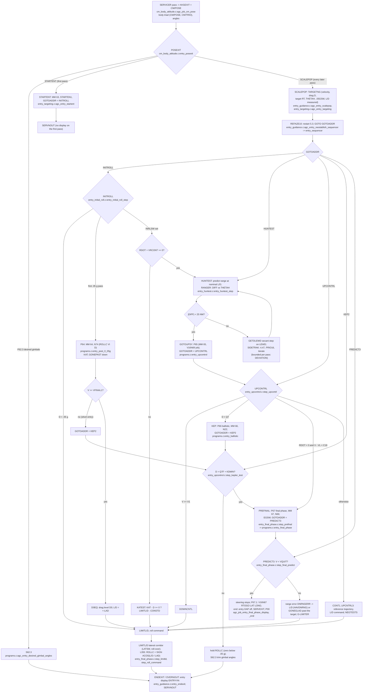

# CSM Earth entry (P61 to P67)

AGC: Comanche055 P61-P67.agc (pp.789-818), REENTRY_CONTROL.agc
(pp.844-875), CM_BODY_ATTITUDE.agc (pp.883-888), CM_ENTRY_DIGITAL_
AUTOPILOT.agc, ENTRY_LEXICON.agc. C: `src/csm/entry/{programs,
cm_body_attitude,dap,lexicon}.c` and REENTRY_CONTROL split by its own
phases: `src/csm/entry/{entry_guidance,entry_targeting,entry_initial_roll,
entry_huntest,entry_upcontrol,entry_final_phase}.c`.

P61 and P62 are crew dialogues before entry; from P63 on the programs are
selected by the entry guidance itself as the flight passes its phase
boundaries. Guidance runs once per 2-second SERVICER pass as the AVGEXIT
job CM/POSE; its sections are step functions run by `entry_sequencer`
(entry_guidance.c), resuming at GOTOADDR, the AGC's own restart-protected
continuation.

## Preparation (P61, P62)

```mermaid
flowchart TD
    A["V37 N61: P61<br/>programs.c:agc_job_entry_preparation<br/>extended verbs locked out; HEADSUP = -1"] --> A1["S61.1 IMU check<br/>programs.c:agc_job_entry_imu_check"]
    A1 --> A2{"R02 ok? AVERAGEG running?"}
    A2 -- "not running" --> A3["MIDTOAV2 then S61.1C task at the state time:<br/>PREREAD starts AVERAGEG (5.41)<br/>agc_job_entry_imu_check_extrapolated, agc_task_entry_start_average_g"]
    A2 -- "running" --> A4
    A3 --> A4["S61.1A: IMU Y axis within 30 deg of UNIT(VN x RN)?<br/>programs.c:agc_job_entry_imu_axis_test"]
    A4 -- "-Y within 30 deg" --> A5["ALARM 1427 (IMU reversed), V05N09"]
    A4 -- "neither" --> A6["ALARM 1426 (unsatisfactory), V05N09"]
    A4 -- "ok" --> B0
    A5 --> B0
    A6 --> B0
    B0["P61: V06N61 LAT(SPL) LNG(SPL) HEADSUP (GOFLASHR)<br/>agc_job_entry_preparation_target_display<br/>4.1 restart at the display (P61.3)"] -- "PROCEED" --> B1["P61.4: ROLLC from HEADSUP; NEWRNVN, STARTEN1<br/>target at PIPTIME (retry if SERVICER moved RN, VN);<br/>S61.2 EMS data<br/>agc_job_entry_preparation_compute, agc_entry_ems_data"]
    B1 --> B2["P61.1: V06N60 GMAX VPRED GAMMAEI"]
    B2 -- "PROCEED" --> B3["P61.2: V06N63 RTGO VIO TTE<br/>(TTE corrected for display time)"]
    B3 -- "PROCEED" --> C0["P62: NEWMODE 62, entry downlist<br/>programs.c:agc_job_cm_sm_separation_newmode"]
    C0 --> C1["S61.1 again; POSEXIT = P62.3; CM/DAPIC<br/>agc_job_cm_sm_separation_after_check"]
    C1 --> C2["P62.2: AVGEXIT = CM/POSE; V50N25 00041<br/>(perform CM/SM separation)"]
    C2 -- "PROCEED" --> C3["CM/DAPON: entry DAP on, NODOFLAG set<br/>agc_job_cm_sm_separation_proceed"]
    C3 --> C4["P62.1: V06N61 again"]
    C4 -- "PROCEED" --> C5["end attitude hold: ROLLC, ALFACOM = ALFAPAD,<br/>BETACOM = 0; P63FLAG = +1; N22 display<br/>agc_job_cm_sm_separation_end_hold"]
    C5 --> C6{"CMDAPMOD = -1 or +0?"}
    C6 -- "yes" --> D0
    C6 -- "no" --> C7["wait for WAKEP62 (entry DAP: ALFA near trim)<br/>agc_task_wake_cm_sm_separation"]
    C7 --> D0["P63: POSEXIT = STARTENT; N64 display;<br/>P63FLAG = -1; group 4 off<br/>programs.c:agc_job_entry_initialization"]
```

## Entry guidance, every 2 s

The entry DAP (`src/csm/entry/dap.c`: READGYMB every 0.1 s, ATTRATES by
T5RUPT, the predictive roll system CM/RCS every 2 s with JETCALL tasks on
channel 6) flies the roll command ROLLC with the RCS jets; the guidance
above only computes ROLLC and the displays. V37 is refused while NODOFLAG is set (from CM/DAPON on;
[program-change.md](program-change.md)).
