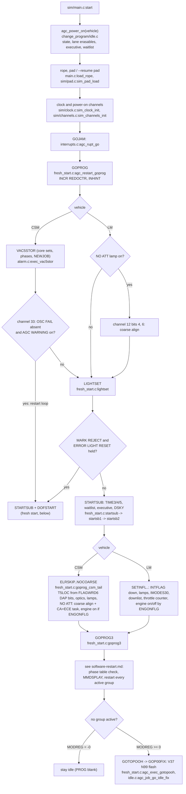
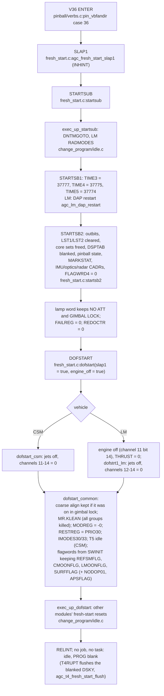

# Fresh start and hardware restart (GOJAM)

AGC: FRESH_START_AND_RESTART.agc (C pp.183-194, L pp.211-223): SLAP1,
DOFSTART / DOFSTRT1, STARTSUB / STARTSB1 / STARTSB2, GOPROG, LIGHTSET,
GOPROG3, GOTOPOOH, GOP00FIX. C: `src/exec/fresh_start.c`,
`src/exec/change_program/idle.c`; the power-on driver is
`src/sim/main.c`.

Three ways in: power-on (GOJAM from the harness), a hardware restart
(GOJAM), and V36 (SLAP1, a crew-requested fresh start). A fresh start
throws the running programs away (every restart group killed); a
hardware restart keeps them and re-runs them from the phase tables.

## Power-on and GOJAM

At power-on the harness has zeroed every erasable (`agc_state_init`) and
the phase tables start with every group killed (phase_table.c), so
GOPROG3 finds no active group and, with MODREG = +0, goes to P00 through
GOTOPOOH, which is what yaAGC shows with a blank core image.

## Fresh start (V36 SLAP1, DOFSTART)

Other ways into DOFSTART: `agc_fresh_dofstart` (machine-initiated),
LIGHTSET (MARK REJECT + ERROR RESET during a restart) and PTBAD (alarm
1107 when a -PHASEn is not the complement of PHASEn, `phase_tables_ok`;
on the LM that path is DOFSTRT1, which leaves the engine alone).
