# IMU realign (P52; CSM shown, LM differences noted)

AGC: P51-P53.agc (Comanche pp.739-762, Luminary pp.927-952): PROG52,
P52B, P52T, P52D, COARSTYP, CAL53A, FINEONLY, GYCRS, P52C, P52E (LOCSAM,
PICAPAR), R51 (R51.3, R51DSP, R51ST, R51A, R51K), R54 (CHKSDATA), R55
(gyro torquing), R52/R53 (auto optics, sighting marks). C:
`src/programs/alignment/imu_realign.c` (shared), `src/csm/alignment/
{imu_realign,fine_align}.c`, `src/lm/alignment/*.c`,
`src/programs/alignment/sighting_data_and_gyro_torquing.c`, IMU moding in
`src/imu/`.

The program is a dialogue: each flash carries three continuations
(terminate / proceed / enter), written below as V34 / V33 / ENTER.
Every V34 goes to P00 (`AGC_JOB_GOTOPOOH`). Where the shared steps go on
in the vehicle's own code (the AGC's TC/TCF to a label of the rope being
flown) the C jumps by registry id, `agc_exec_jump(ctx, id)`, and the one
row names the CSM and the LM body (tools/registry.tsv):
`AGC_JOB_IMU_REALIGN_STARS` (CSM P52C, LM R51),
`AGC_JOB_IMU_REALIGN_RECHECK` (R51K) and
`AGC_JOB_IMU_REALIGN_LANDING_SITE` (P52LS).

```mermaid
flowchart TD
    A["V37 N52: PROG52<br/>imu_realign.c:agc_job_imu_realign<br/>CSM: 4.25; UPDATFLG, TRACKFLG down"] --> A1["R02 IMU status<br/>imu:agc_imu_status_check"]
    A1 -- "IMU off / no REFSMMAT (alarm 210 / 220)" --> A2["P00 already started: job ends"]
    A1 -- "ok" --> A3["OPTION2 = preferred if PFRATFLG, else nominal"]
    A3 --> B["P52B: flash V04N06 option<br/>imu_realign.c:agc_job_imu_realign_option_display"]
    B -- "V33" --> B1{"OPTION2 & 3<br/>imu_realign.c:agc_job_imu_realign_option"}
    B -- "ENTER (new option)" --> B
    B1 -- "1 preferred" --> D
    B1 -- "2 nominal" --> T
    B1 -- "0 landing site" --> T
    B1 -- "3 REFSMMAT" --> SS
    T["P52T: flash alignment time (N34)<br/>agc_job_realign_time_flash"] -- "V33" --> T1{"time = 0 (major word)?<br/>agc_job_realign_time_proceed"}
    T1 -- "yes" --> T2["use now (LOADTIME)"]
    T1 -- "no" --> T3["use keyed time"]
    T2 --> T4{"nominal (OPTION2 bit 2)?"}
    T3 --> T4
    T4 -- "yes" --> T5["S52.3 nominal REFSMMAT (integrates the state;<br/>may sleep in INTSTALL)<br/>agc_job_realign_nominal_orientation"]
    T4 -- "no" --> T6["P52LS landing-site orientation (jump AGC_JOB_IMU_REALIGN_LANDING_SITE)<br/>csm/alignment/imu_realign.c:agc_job_csm_imu_realign_landing_site"]
    T5 --> D
    T6 --> D
    D["P52D: S52.2 gimbal angles for XSMD;<br/>flash V06N22<br/>agc_job_realign_gimbal_display"] -- "V33" --> C0
    D -- "ENTER (vehicle moved)" --> D
    C0["COARSTYP: V50N25 00013<br/>agc_job_coarstyp"] -- "V33 coarse align" --> C1
    C0 -- "V32 gyro torque" --> G0
    C1["CAL53A: S52.2 again, read CDUs<br/>agc_job_coarse_align"] --> C2{"any gimbal > 1 deg from THETAD?<br/>imu:agc_align_coarse_needed"}
    C2 -- "yes" --> C3["4.2; COARSE (IMU coarse align, IMUSTALL);<br/>drift compensation restarted<br/>agc_job_coarse_align_coarsed"]
    C2 -- "no" --> C4
    C3 --> C4["FINEONLY: REFSMMAT = XSM; REFSMFLG up<br/>agc_job_coarse_align_fineonly"]
    G0["GYCRS: XDC = desired SM wrt present SM;<br/>CALCGTA; DRIFTFLG, REFSMFLG down;<br/>monitor gimbals; IMUPULSE + IMUSTALL<br/>agc_job_gycrs .. agc_job_gycrs_pulsed"] --> G1["REFSMMAT = XSMD; PFRATFLG down, REFSMFLG up;<br/>drift compensation restarted<br/>agc_job_gycrs_torqued"]
    G1 --> K
    C4 --> SS["P52C: 4.2; V50N25 00015 (star acquisition)<br/>(jump AGC_JOB_IMU_REALIGN_STARS)<br/>csm/alignment/imu_realign.c:agc_job_csm_realign_star_selection"]
    SS -- "V33 (computer picks)" --> P0["TSIGHT = now + 4 min; LOCSAM; PICAPAR<br/>agc_job_csm_realign_pick_stars, realign_pick_stars"]
    SS -- "ENTER (crew picks)" --> R0
    P0 --> P1{"star pair found?"}
    P1 -- "no" --> P2["ALARM 405; V05N09<br/>V33: fine align anyway, ENTER: P52C again"]
    P2 --> R0
    P1 -- "yes" --> R0
    R0["R51: STARIND = 1<br/>csm/alignment/fine_align.c:agc_job_csm_fine_align"] --> R1["R51.3: TARG1/2FLG down; restart phase (job at PRIO13);<br/>flash V01N70 star code<br/>agc_job_csm_fine_align_next_star .. _star_display"]
    R1 -- "V33" --> R2{"CHKSCODE: valid star code?"}
    R2 -- "no" --> R3["OPR ERR (FALTON); show code again"] --> R1
    R2 -- "yes" --> R4["PLANET (LOS at now)<br/>agc_job_csm_fine_align_star_accepted"]
    R4 --> R5{"MODREG = 54 (backup)?<br/>agc_job_csm_fine_align_star_located"}
    R5 -- "yes" --> R6["R56 alternate LOS mark"]
    R5 -- "no" --> R7["R52 auto optics + R53 sextant marks<br/>csm/optics:agc_csm_auto_optics_positioning"]
    R6 --> R8["R51A: observed LOS (SXTSM); MKRELEAS; PLANET at TSIGHT<br/>agc_job_csm_fine_align_marked"]
    R7 --> R8
    R8 --> R9{"first star?<br/>agc_job_csm_fine_align_star_at_mark"}
    R9 -- "yes" --> R1
    R9 -- "no" --> S0["R54: angle difference; flash V06N05<br/>sighting_data_and_gyro_torquing.c:agc_align_sighting_data_display"]
    S0 -- "V33: accept (FREEFLAG up)" --> S1["AXISGEN: XDC<br/>agc_job_csm_fine_align_data_checked, agc_align_fine_solve"]
    S0 -- "ENTER: reject (FREEFLAG down)" --> K
    S1 --> S2["R55: CALCGTA; flash V06N93 torque angles<br/>agc_align_gyro_torquing"]
    S2 -- "V33" --> S3["IMUPULSE OGC buffer; IMUSTALL (bad end: CURTAINS)<br/>agc_job_gyro_torquing_pulse"]
    S2 -- "ENTER: no torquing" --> S4
    S3 --> S4["PFRATFLG down<br/>agc_job_csm_fine_align_torqued"]
    S4 --> K["R51K: V50N25 00014 (fine align check)<br/>(from GYCRS: jump AGC_JOB_IMU_REALIGN_RECHECK)<br/>fine_align.c:agc_job_csm_fine_align_recheck"]
    K -- "V33" --> SS
    K -- "ENTER" --> Z["P00 (GOTOPOOH)"]
```

LM differences (same shared functions, `is_csm()` false):

* No phase 4.25 / UPDATFLG at entry; option 0 shows TLAND
  (`agc_job_imu_realign_option`); a zero or negative keyed time means now
  (BZMF, `agc_job_realign_time_proceed`).
* Option 3 goes straight to R51 (`agc_job_lm_fine_align`, lm/alignment/
  fine_align.c) with QMAJ = P52OUT, and so does FINEONLY after a coarse
  align (PFRATFLG cleared there).
* Marks are AOT marks (`lm/optics/aotmark.c`), and the drift compensation
  restart is NCOARSE rather than SET1/PDT (`drift_compensation_restart`).
