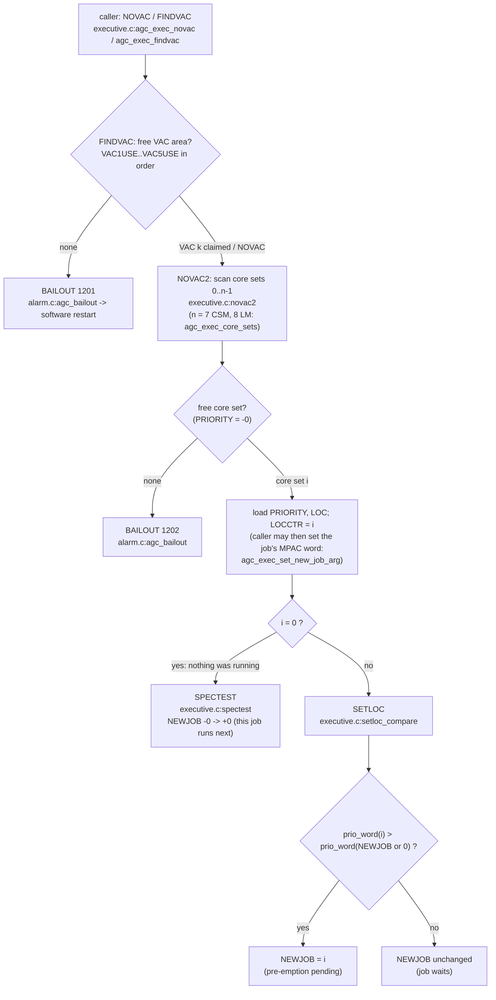
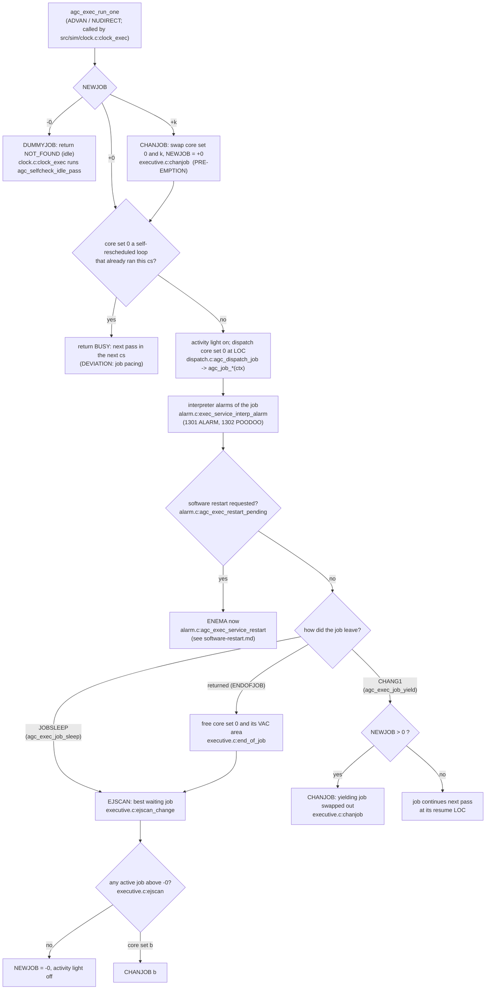

# Job creation and pre-emption (executive)

AGC: EXECUTIVE.agc (C pp.1208-1220, L pp.1103-1116): NOVAC, FINDVAC,
NOVAC2, SPECTEST, SETLOC, CHANJOB, ENDOFJOB, EJSCAN, JOBSLEEP, JOBWAKE,
CHANG1, PRIOCHNG, DUMMYJOB. C: `src/exec/executive.c`.

A job never loses the processor inside its C body. It is pre-empted at
the next `agc_exec_run_one` (the swap with core set NEWJOB happens before
dispatch) or, if it offers the processor with `agc_exec_job_yield`
(CHANG1), right after it returns. The decision of *who* runs next is the
AGC's: the priority word (priority << 9 + VAC rank, negative while
asleep) compared exactly as SETLOC and EJSCAN compare it (`prio_word`).

## Creating a job

## Running jobs

Other entries that move NEWJOB:

* `agc_exec_job_wake` (JOBWAKE): finds the sleeping core set whose LOC
  is the given id, makes it active and treats it as a new job (SPECTEST
  or SETLOC); not found is NOT_FOUND (`agc_exec_job_wake_if_asleep` turns
  that into OK where the AGC does not care).
* `agc_exec_prio_change` (PRIOCHNG): new priority for the running job;
  if a waiting job is now strictly higher NEWJOB names it, and the caller
  yields with `agc_exec_job_yield` and returns (the AGC changes job
  inside PRIOCHNG).

Deviation (executive.c NOTES): a long C job body delays a newly created
higher-priority job until it returns or yields; MPAC, OVFIND and the VAC
contents are not saved by the executive (a job keeps its data in locals
or module erasables). A job whose last pass ended in CHANG1 to its own
LOC (a polling or recomputing loop: R31/R34 V83 COMPDISP, CHECKG1's PIPA
catch) gets its next pass in the next centisecond (`agc_exec_run_one`
returns BUSY until then): a C pass takes no AGC time, so without it such
a loop ran up to the host's job bound where the AGC runs it a few times a
second. With the landing radar read wait (`landing_radar.c:agc_job_lrvjob`)
it is one of the two ordering deviations that stand in for AGC execution
time (docs/ARCHITECTURE.md, "Known limitations").
