# LM lunar landing (P63 braking, P64 approach, P65/P66/P67, P68)

AGC: Luminary099 THE_LUNAR_LANDING.agc (pp.785-792), LUNAR_LANDING_
GUIDANCE_EQUATIONS.agc (pp.797-826), THROTTLE_CONTROL_ROUTINES.agc,
BURN_BABY_BURN--MASTER_IGNITION_ROUTINE.agc (pp.731-743), SERVICER.agc
(pp.857-896), P70-P71.agc. C: `src/lm/landing/{lunar_landing,guidance,
throttle,findcduw,displays,aborts}.c`, `src/lm/burns/ignition/
{burnbaby,clock}.c`, `src/lm/burns/servicer/{average_g,landing_radar}.c`.

The landing is one guidance loop (LUNLAND, every 2 s from SERVICER) whose
phase is held in WCHPHASE: IGNALG (-1, before ignition), BRAKQUAD (P63),
APPRQUAD (P64), VERTICAL (P65/P66/P67). The quadratic phases end when
TTF/8 passes TENDBRAK / TENDAPPR (`ldg_extlogic`); the vertical modes are
chosen by the crew's switches (`agc_lm_guildenstern`).

## P63: ignition algorithm and countdown

```mermaid
flowchart TD
    A["V37 N63: P63LM / FLAGORGY<br/>lunar_landing.c:agc_lm_job_braking_phase<br/>restart point (PHASCHNG 04024)"] --> A1["R02 IMU status"]
    A1 -- "bad" --> A2["P00 (R02 alarmed)"]
    A1 -- "ok" --> A3["WHICH = P63 row; DVTHRUSH, DVCNTR = 4;<br/>WCHPHASE = IGNALG; RR lock-on off;<br/>NOTHROTL, REDFLAG, LRBYPASS down; MUNFLAG up;<br/>P25 and P20 (RNDVZFLG) off"]
    A3 --> A4["landing site RLS to SM at TLAND; LAND;<br/>GUIDINIT (WM, /LAND/)<br/>nav:agc_planet_rp_to_r, ascent.c:agc_lm_guidinit"]
    A4 --> A5["IGNALG: LEMPREC to TLAND - GUIDDURN<br/>lunar_landing.c:ll_ignalg_prec<br/>(integration busy: sleep, agc_lm_job_ignalg_prec)"]
    A5 --> B0["IGNALOOP pass<br/>lunar_landing.c:ll_ignaloop"]
    B0 --> B1["?GUIDSUB / GUIDSUB: three quadratic guidance passes<br/>lunar_landing.c:ll_ign_guidance -> guidance.c:agc_lm_guidpass"]
    B1 --> B2["DDUMCALC: ignition-time correction DDUM (cs 2^28);<br/>TDEC1 = PIPTIME1 + DDUM"]
    B2 --> B3{"|DDUM| < DDUMCRIT?"}
    B3 -- "no" --> B4["INTSTALL; integrate the state to TDEC1<br/>(sleep while busy: agc_lm_job_ignaloop)"]
    B4 --> B0
    B3 -- "yes" --> B5["DDUMGOOD / R60INIT: TIG = TDEC1 - ZOOMTIME;<br/>OUTOFPLN; R60VSAVE = UNFC/2"]
    B5 --> C0["IGNALGRT: countdown clock (STCLOK2) -> ASTNRET<br/>lunar_landing.c:agc_lm_job_ignalgrt"]
    C0 --> C1["ASTNRET: QMAJ = P63SPOT2; R51 check flash<br/>(PROCEED fine align, ENTER go on)<br/>lunar_landing.c:agc_lm_job_astnret"]
    C1 --> C2["P63SPOT2: burn attitude +X along R60VSAVE,<br/>1 deg deadband; R60 attitude maneuver<br/>lunar_landing.c:agc_lm_job_braking_phase_burn_attitude"]
    C2 --> C3{"P63SPOT3: LR antenna in position 1?<br/>(channel 33)"}
    C3 -- "no" --> C4["V50N25 00500: crank the antenna<br/>PROCEED: check again, ENTER: go on"]
    C4 --> C3
    C3 -- "yes" --> C5["P63SPOT4: SETPOS1 (LR beam vectors)<br/>agc_lm_job_braking_phase_radar_init"]
    C5 --> D0["BURNBABY: group 4; DVTOTAL = 0; P40AUTO<br/>burnbaby.c:agc_lm_burnbaby, agc_job_burnbaby_countdown"]
    D0 --> D1["P41SPOT/P63SPOT: TDEC1 = TIG - 29.9 s; INITCDUW;<br/>CSM state for MUNRVG; MIDTOAV1 (slip TIG if late);<br/>CALLT-35: SAVET-30 = time to TIG - 35 s, LONGCALL TIG-35<br/>(<= 0: LONGCALL of 0 = POODOO 1204, as the AGC)<br/>burnbaby.c:agc_job_preburn_state_vector_lm, ign_call_tig_35"]
    D1 --> D2["TIG-35: blank DSKY 5 s; TIG-30 in 5 s<br/>burnbaby.c:agc_task_tig_35"]
    D2 --> D3["TIG-30: TIG-5 in 24.9 s; display on; ullage task;<br/>ULLGNOT: AVGEXIT from the table; PREREAD (SERVICER)<br/>burnbaby.c:agc_task_tig_30, ullgnot"]
    D3 --> D4["TIG-5: TIG-0 in 5 s; IGNFLAG, ASTNFLAG down;<br/>S40.13; V99 request<br/>burnbaby.c:agc_task_tig_5_lm"]
    D4 --> D5["TIG-0: IGNFLAG up; in P63 throttle-up task<br/>P63ZOOM in ZOOMTIME<br/>burnbaby.c:agc_task_tig_0_lm"]
    D5 --> D6{"IGNYET?: crew answered V99 (ASTNFLAG)?<br/>burnbaby.c:agc_task_ignition_if_enabled"}
    D6 -- "no" --> D7["WAITABIT: ignition on V99 PROCEED"]
    D6 -- "yes" --> D8["IGNITION: ENGONFLG; DPS on (ch 11 bits 13/14);<br/>TEVENT; FLUNDISP down<br/>burnbaby.c:agc_task_ignition_lm"]
    D7 --> D8
    D8 --> D9["P63IGN: AVGEXIT = P63DISPS; LETABORT (P70/P71 allowed);<br/>R10 on; WCHPHASE = BRAKQUAD (WCHPHOLD)<br/>burnbaby.c:braking_phase_ignition"]
    D9 --> D10["P63ZOOM task: AVGEXIT = LUNLAND; FLATOUT (full thrust)<br/>burnbaby.c:agc_task_braking_phase_zoom"]
```

## Powered descent: the 2-second guidance loop

```mermaid
flowchart TD
    S0["READACCS task (2 s)<br/>average_g.c:agc_task_readaccs_lm"] --> S1["SERVICER: GETABVAL, mass (MASSMON), MUNRVG<br/>(LM + CSM state, spherical moon)<br/>average_g.c:agc_job_servicer_lm, getabval"]
    S1 --> S2["DVMON: thrust seen (ABDELV > DVTHRUSH)?<br/>STEERSW up; else LOTHRUST countdown<br/>average_g.c:dvmon, lothrust"]
    S2 --> S3["landing radar: altitude below 50 000 ft enabled;<br/>UPDATCHK / VMEASCHK accept or reject readings,<br/>LR lamps (R12); LRVJOB / HIGATJOB wait while<br/>LRHJOB holds the radar (DEVIATION: AGC time)<br/>landing_radar.c:agc_lm_serv_munretrn .. vmeaschk, agc_job_lrvjob"]
    S3 --> S4["COPYCYCL; SERVOUT: 1/ACCS, AVGEXIT<br/>average_g.c:agc_lm_serv_copycycl, servout"]
    S4 --> L0["LUNLAND (AVGEXIT)<br/>guidance.c:agc_lm_job_lunland<br/>group 5 PIPA only; group 3 = LUNLAND at PRIO21"]
    L0 --> R13{"R13 GUILDENSTERN<br/>lunar_landing.c:agc_lm_guildenstern"}
    R13 -- "manual throttle (ch 30 AUTOTHROT absent)" --> P67["P67: NEWMODE 67; VRTSTART<br/>-> VERTGUID"]
    R13 -- "in P67, auto throttle back" --> P66a["STARTP66: P66"]
    R13 -- "no attitude hold (ch 31)" --> GR["GUILDRET: automatic guidance"]
    R13 -- "attitude hold, in P66" --> V66["continue P66 (re-init after a restart)<br/>-> VERTGUID"]
    R13 -- "attitude hold, ROD switch clicked" --> P66a
    R13 -- "attitude hold, no ROD click" --> GR
    P66a --> VG
    P67 --> VG
    V66 --> VG
    GR --> F0["new times; phase start on the first pass<br/>guidance.c:ldg_front"]
    F0 --> F1{"WCHPHASE (first pass of a phase)"}
    F1 -- "APPRQUAD" --> F2["STARTP64: NEWMODE 64; TTF/8 += DELTTFAP;<br/>RUPT10 (LPD) on; REDFLAG down<br/>guidance.c:agc_lm_start_approach_phase"]
    F1 -- "VERTICAL" --> F3["P65START: NEWMODE 65; WCHVERT = -2;<br/>X-axis override allowed<br/>guidance.c:agc_lm_start_velocity_nulling"]
    F1 -- "otherwise" --> F4
    F2 --> F4["TTFINCR: TTF/8 advanced, LAND rotated with the moon<br/>guidance.c:agc_lm_ttfincr"]
    F3 --> F4
    F4 --> F5{"phase"}
    F5 -- "APPRQUAD" --> F6["REDESIG: move LAND by the LPD clicks<br/>(REDFLAG, TREDES > 0)<br/>lunar_landing.c:agc_lm_redesig"]
    F5 -- "BRAKQUAD / VERTICAL" --> F7["RGVGCALC: state in guidance frame,<br/>RANGEDSP, LOOKANGL<br/>guidance.c:agc_lm_rgvgcalc"]
    F6 --> Q0
    F7 --> Q00{"VERTICAL?"}
    Q00 -- "yes" --> VG
    Q00 -- "no" --> Q0["TTF/8CL: solve the time-to-go cubic<br/>(ROOTPSRS, at most 8 Newton passes)<br/>guidance.c:agc_lm_ttf8cl"]
    Q0 -- "no root" --> Q1["ALARM 1406, RATESTOP, displays<br/>(before ignition: POODOO 1406)"]
    Q0 -- "TTF/8" --> Q2["QUADGUID: ACG; AFCCALC: UNFC/2, /AFC/<br/>guidance.c:agc_lm_quadguid, agc_lm_afccalc"]
    Q2 --> Q3["CGCALC: guidance frame (only inside its TTF window)<br/>guidance.c:agc_lm_cgcalc"]
    Q3 --> Q4{"EXTLOGIC: TTF/8 past TENDBRAK / TENDAPPR?<br/>guidance.c:ldg_extlogic"}
    Q4 -- "yes" --> Q5["WCHPHASE = next phase, FLPASS0 = 0<br/>(next pass starts P64 or P65)"]
    Q4 -- "no" --> Q6
    Q5 --> Q6["window vector UNWC/2 (EXBRAK / EXNORM)"]
    Q6 --> ST
    VG{"VERTGUID: WCHVERT<br/>guidance.c:agc_lm_vertguid"}
    VG -- "> 0: P67" --> M67["P67VERT: VHORIZ only; group 3 off<br/>lunar_landing.c:agc_lm_manual_landing_vertical"]
    VG -- "0: P66" --> M66["P66VERTA: RODTASK every second; RODCOMP:<br/>ROD clicks -> VDGVERT, /AFC/, THROTTLE +3<br/>lunar_landing.c:agc_lm_rate_of_descent_vertical, ll_rodcomp"]
    VG -- "< 0: P65" --> M65["ACG = (V2FG - VGU)/TAUVERT; AFCCALC"]
    M65 --> ST
    ST{"STEER?: STEERSW and no overflow?<br/>guidance.c:agc_lm_steer_exit"}
    ST -- "STEERSW down" --> ST1["RATESTOP"]
    ST -- "overflow" --> ST2["ALARM 1410; RATESTOP"]
    ST -- "yes" --> ST3["THROTTLE (throttle.c:agc_lm_throttle);<br/>FINDCDUW attitude commands (findcduw.c)"]
    ST1 --> DX
    ST2 --> DX
    ST3 --> DX["DISPEXIT: group 3 off; V06N63 (P63),<br/>V06N64 (P64, PROCEED enables LPD), V06N60 (P65-P67)<br/>guidance.c:agc_lm_dispexit"]
```

## Touchdown and aborts

* After touchdown the crew selects P68 (V37 N68, mode table in
  `exec/change_program/lm.c`): LANDJUNK zeroes the attitude error, sets
  the 5 degree deadband and the surface flags, computes LAT/LONG/ALT of
  the landing point and RLS, and flashes V06N43; PROCEED stores the
  gravity and attitude for P57 (`agc_lm_job_landing_confirmation` ..
  `agc_lm_job_landing_confirmation_proceed`, lunar_landing.c).
* R10/R11 (`agc_lm_task_abort_monitor`, aborts.c) runs every quarter
  second from SERVICER: with LETABORT set, the ABORT STAGE discrete
  starts P71 and ABORT starts P70 (`agc_lm_abort_monitor_resume` ->
  `ab_abrtjask`); a V37 N70/N71 is checked by LEGAL? (`ab_legal`: not
  already running, aborts enabled, SERVICER on) and refused with OPR ERR
  otherwise. The abort guidance continues in the ascent equations
  ([powered-ascent.md](powered-ascent.md)).
* Low thrust: after DVCNTR low-thrust passes SERVICER starts COMFAIL
  (`average_g.c:lothrust`); meanwhile STOPRATE zeroes the rate commands.
