# LM powered ascent (P12) and the ascent guidance

AGC: Luminary099 P12.agc (pp.838-840), ASCENT_GUIDANCE.agc (pp.841-856),
BURN_BABY_BURN (P12 row), SERVICER.agc. C: `src/lm/ascent.c`,
`src/lm/burns/ignition/burnbaby.c`, `src/lm/burns/servicer/average_g.c`.
The same ascent equations fly the aborts P70/P71 (`src/lm/landing/
aborts.c`), entered through ABRTJASK / GOABORT instead of P12.

```mermaid
flowchart TD
    A["V37 N12: P12LM<br/>ascent.c:agc_lm_job_powered_ascent<br/>restart point (PHASCHNG 04024)"] --> A1["R02 IMU status"]
    A1 -- "bad" --> A0["P00 (R02 alarmed)"]
    A1 -- "ok" --> A2["MUNFLAG, ACC4-2FL (4-jet), R10FLAG;<br/>RADMODES for R29; RNDVZFLG down;<br/>DVTHRUSH, DVCNTR = 4"]
    A2 --> A3["flash V06N33 TIG<br/>agc_lm_job_powered_ascent_flash"]
    A3 -- "PROCEED" --> B0["WM, /LAND/ (GUIDINIT); APS data (P12INIT,<br/>COMMINIT targets: RCO = /LAND/ + 60 000 ft, QAXIS);<br/>LEMPREC to TIG (may wait for the integration)<br/>agc_lm_job_powered_ascent_proceed"]
    A3 -- "TERMINATE" --> A0
    B0 --> B1["P12LMB: V1S, R, gravity, UNIT/R/ at TIG;<br/>XRANGE for N76; injection targets<br/>agc_lm_job_powered_ascent_at_ignition"]
    B1 --> B2["NEWLOAD: flash V06N76 cross range, apolune<br/>agc_lm_job_newload"]
    B2 -- "PROCEED" --> B3["YCO; tip-over velocity V(IGN) + 49 ft/s UNIT/R/;<br/>RDOT, ZAXIS1; FLPI set: one ASCENT pass<br/>agc_lm_job_newload_proceed"]
    B3 --> B4["P12RET: yaw and pitch of the thrust command,<br/>1 deg deadband<br/>agc_lm_powered_ascent_return"]
    B4 --> B5["P12BURN: FLPI off; BURNBABY countdown<br/>(TIG-35, TIG-30, TIG-5, V99, TIG-0 as in lunar-landing.md)<br/>agc_lm_job_powered_ascent_burn -> burnbaby.c:agc_lm_burnbaby"]
    B5 --> B6["IGNITION; P12IGN: DAP bias AOSQ, AOSR from pad;<br/>ABRTIGN: CLOKTASK off, AVGEXIT = ATMAG, R10 on<br/>burnbaby.c:ascent_bias_load, ascent_ignition"]
    B6 --> C0["SERVICER every 2 s -> ATMAG<br/>ascent.c:agc_lm_job_atmag"]
    C0 --> C1{"FLRCS (RCS trim after cut-off)?"}
    C1 -- "no" --> C2{"ABDVCONV below 1.1 lunar g?"}
    C2 -- "yes" --> C3["ASCTERM4: zero attitude errors,<br/>no guidance this cycle, N63 display"]
    C2 -- "no" --> C4["SURFFLAG, RENDWFLG down;<br/>1/DV history -> TBUP, AT"]
    C1 -- "yes" --> C5
    C4 --> C5["ASCENT: state in the ascent frame, GEFF, VG,<br/>VGBODY for N85<br/>ascent.c:agc_lm_ascent, as_vgvect"]
    C5 --> C6{"FLRCS?"}
    C6 -- "yes" --> C7["TGO = VG / ATRCS; end"]
    C6 -- "no" --> C8["MAINENG: TGO = TBUP (VG/VE)(1 - KT VG/VE) - TTO;<br/>TTOGO"]
    C8 --> C9{"TGO < 4 s and DVMON on (IDLEFLAG clear)?"}
    C9 -- "yes" --> C10["ENGOFF: engine-off task at TGO (at least 1 cs),<br/>group 4 variable restart; IDLEFLAG (DVMON off)<br/>ascent.c:as_engoff"]
    C9 -- "no" --> C11
    C10 --> C11["T2TEST / CONST: steering constants A, C;<br/>B, D only until TGO reaches T3; RATES<br/>ascent.c:as_t2test, as_rates"]
    C11 --> C12["CMPONENT / AIMER: thrust components 1 s ahead,<br/>UNFC/2 = AH + ATP ZAXIS1<br/>ascent.c:as_cmponent"]
    C12 --> C13{"FLVR: vertical rise?"}
    C13 -- "yes" --> V0{"altitude above /LAND/ + 25 000 ft?"}
    V0 -- "yes" --> V1["EXITVR: FLVR down;<br/>ROTFLAG clear: rise 10 s more (TXO)<br/>ascent.c:as_exitvr"]
    V0 -- "no" --> V2{"LOS within 5 deg of YZ plane<br/>and RDOT >= 40 ft/s?"}
    V2 -- "yes" --> V3["ROTFLAG down; EXITVR"]
    V2 -- "no" --> V4["KEEPVR: thrust radial, UNFC/2 = UNIT/R/;<br/>X override prohibited"]
    V3 --> V1
    V1 --> M0
    C13 -- "no" --> M0["MAINLINE: window toward -UNIT/R/<br/>ascent.c:as_mainline"]
    M0 --> M1{"before TXO?"}
    M1 -- "yes" --> AT
    M1 -- "no, ROTFLAG" --> M2{"pitch-over angle checks<br/>(COSTHET1, COSTHET2)"}
    M2 -- "not yet" --> V4
    M2 -- "done" --> M3["ROTFLAG down; R29 allowed;<br/>X override allowed"]
    M3 --> AT
    V4 --> AT
    AT["ASCTERM: FINDCDUW (unless RCS trim);<br/>V06N63 / V16N85 displays<br/>ascent.c:as_ascterm"]
    E0["ENGOFF1 task at TGO: engine off (ENGINOF2);<br/>FINDVAC CUTOFF (PRIO17), restart type C<br/>ascent.c:agc_lm_task_ascent_engine_off"] --> E1["CUTOFF: FLRCS set; V16N63 flash<br/>agc_lm_job_cutoff"]
    E1 -- "PROCEED" --> E2["CUTOFF1: zero attitude errors, min deadband;<br/>CUTOFF2: V16N85 (VGBODY) flash<br/>agc_lm_job_cutoff_proceed, _trim_display"]
    E1 -- "TERMINATE" --> E3
    E2 -- "PROCEED / TERMINATE" --> E3["TERMASC: crew deadband restored,<br/>aborts disallowed, P00<br/>agc_lm_job_termasc"]
```

