# Program change (V37 Nxx ENTER)

AGC: PINBALL MMCHANG / REQMM (C p.365), FRESH_START_AND_RESTART.agc V37,
ISITP00, CHECKTAB, ISSERVON, CANV37/R00, POOH, NOUVEAU, SEUDOP00,
RENDV00, V37XEQ (C pp.197-202, L pp.227-232). C:
`src/io/dsky/pinball/monitor.c`, `src/exec/change_program/sequence.c`,
`csm.c`, `lm.c`, `idle.c`.

The AGC changes program through a software restart: the new program's
first job is the restart point of group 4, so a power transient during
the change still ends in the new program. The C keeps that shape
(sequence.c NOTES): group 4 gets a type C job phase (CANV37 or V37XEQ at
PRIO30) and ENEMA does the rest.

```mermaid
flowchart TD
    K["V37 ENTER: REQMM flashes the noun lights<br/>pinball/monitor.c:pin_reqmm"] --> K1["two digits + ENTER<br/>monitor.c:pin_mmchang_resume"]
    K1 --> K2{"exactly two digits keyed?"}
    K2 -- "no" --> K3["ALMCYCLE: OPR ERR, re-request<br/>pinball/verbs.c:pin_almcycle"]
    K2 -- "yes" --> V0["V37: MMNUMBER = Nxx<br/>change_program/sequence.c:agc_change_program"]
    V0 --> V1{"IMODES30 bit 6:<br/>IMU being initialised?"}
    V1 -- "yes" --> X1["CANTR00: ALARM 1520, RELDSP<br/>sequence.c:cp_refuse(true)"]
    V1 -- "no" --> V2{"LM and Nxx = 70 / 71?"}
    V2 -- "yes" --> V3["SETUP70 / SETUP71: start the abort program now<br/>lm.c:exec_cp_setup_abort -> agc_lm_job_dps_abort / agc_lm_job_aps_abort"]
    V2 -- "no" --> V4{"CSM: SPS engine on (ch 11 bit 13)<br/>or TVC DAP running (FLAGWRD6)?"}
    V4 -- "yes" --> V5["R00TOP00: SPSOFF, MASSPROP, RCS DAP in 3.1 s,<br/>TVCZAP, DELAYJOB 5 cs, jets off, then P00<br/>csm.c:exec_cp_engine_off_to_idle, agc_job_change_program_jets_off"]
    V4 -- "no / LM" --> S0["ISITP00<br/>sequence.c:cp_select"]
    V5 --> S0
    S0 --> S1{"Nxx = 00 ?"}
    S1 -- "no" --> S2{"NODOFLAG set?<br/>(V37 not allowed)"}
    S2 -- "yes" --> X1
    S2 -- "no" --> S3{"Nxx in the vehicle's mode table?<br/>CHECKTAB (csm.c / lm.c:exec_cp_modes_*)"}
    S3 -- "no" --> X2["V37NONO: OPR ERR lamp, RELDSP<br/>sequence.c:cp_refuse(false)"]
    S3 -- "yes: MINDEX" --> S4
    S1 -- "yes" --> S4{"SERVICER running?<br/>(AVEGFLAG)"}
    S4 -- "yes" --> S5["ISSERVON: AVEGFLAG down; SERVICER's last pass<br/>comes back to CANV37 (CSM AVGEND,<br/>LM OUTROUTE = V37RET: lm.c:agc_job_change_program_return)<br/>this job ends"]
    S4 -- "no" --> C0
    S5 -.-> C0["CANV37 / R00<br/>sequence.c:agc_job_change_program_continue"]
    C0 --> C1["group 4 = type C: restart CANV37 at PRIO30"]
    C1 --> C2{"INTSTALL: integration busy?<br/>nav/integration:agc_integ_install"}
    C2 -- "busy" --> C3["sleep; the integration wakes this job<br/>(continues as CANV37)"]
    C2 -- "free" --> C4["clean up outbits and flags<br/>csm.c:exec_cp_cleanup_csm / lm.c:exec_cp_cleanup_lm"]
    C4 --> C5{"MMNUMBER = 0 ?"}
    C5 -- "yes" --> P0["POOH: RELDSP; PHSPRDT2 = PRIO5; NODOFLAG down;<br/>2.5 (STATEINT1); P00 flags; P00 downlist;<br/>V37KLEAN + P00KLEAN; MODREG = 0<br/>sequence.c:cp_pooh"]
    P0 --> R0["GOPROG2 (no group 4)<br/>sequence.c:cp_gogoprog(false)"]
    C5 -- "no" --> N0["NOUVEAU: program flags, downlist (and LM AGSWORD)<br/>sequence.c:cp_nouveau"]
    N0 --> N1["V37KLEAN; RENDV00:<br/>csm.c:exec_cp_rendezvous_csm / lm.c:exec_cp_rendezvous_lm"]
    N1 --> N2{"STATQUO: P20 / P25 asked for<br/>while it already runs?"}
    N2 -- "yes" --> N3["keep group 2, TRACK and UPDATE on;<br/>MODREG = Nxx; GOPROG2 without group 4"]
    N2 -- "no" --> N4["group 4 = type C: V37XEQ at PRIO30;<br/>GOPROG2<br/>sequence.c:cp_gogoprog(true)"]
    R0 --> E["ENEMA at the end of this job<br/>(software-restart.md)"]
    N3 --> E
    N4 --> E
    E --> Q{"group 4 active?"}
    Q -- "V37XEQ" --> Q1["V37XEQ: PHSPRDT4 = program priority;<br/>FINDVAC the program's first job (FCADRMM1);<br/>NEWMODEA: MODREG = Nxx, PROG lights;<br/>RELDSP<br/>sequence.c:agc_job_change_program_start"]
    Q -- "none" --> Q2["P00 / STATQUO: the restarted groups run;<br/>MMDSPLAY shows MODREG"]
```

Decision points and their alarms:

| Test | Where | Result |
|---|---|---|
| IMODES30 bit 6 (IMU initialising) | `agc_change_program` | ALARM 1520 |
| NODOFLAG (V37 not allowed) | `cp_select` | ALARM 1520 |
| Nxx not in FCADRMM1 | `cp_select` | OPR ERR (V37NONO) |
| LM Nxx = 70/71 | `agc_change_program` | P70/P71 started directly, no restart |
| CSM engine on or TVC DAP | `exec_cp_engine_off_to_idle` | engine stopped, then P00 |
| AVEGFLAG (SERVICER on) | `cp_select` | wait for SERVICER's last pass |
| INTSTALL busy | `agc_job_change_program_continue` | sleep until the integration ends |
| RNDVZFLG / P25 flag with Nxx = 20 / 25 | `exec_cp_rendezvous_*` | STATQUO: keep the running P20/P25 |

Deviation (sequence.c NOTES): the AGC's group 4 shows 4.1 (INITDSP
jumping to TEMPFLSH -3); the C uses a type C job phase (PHASE4 reads
05024) because its INITDSP cannot be pointed at TEMPFLSH.
