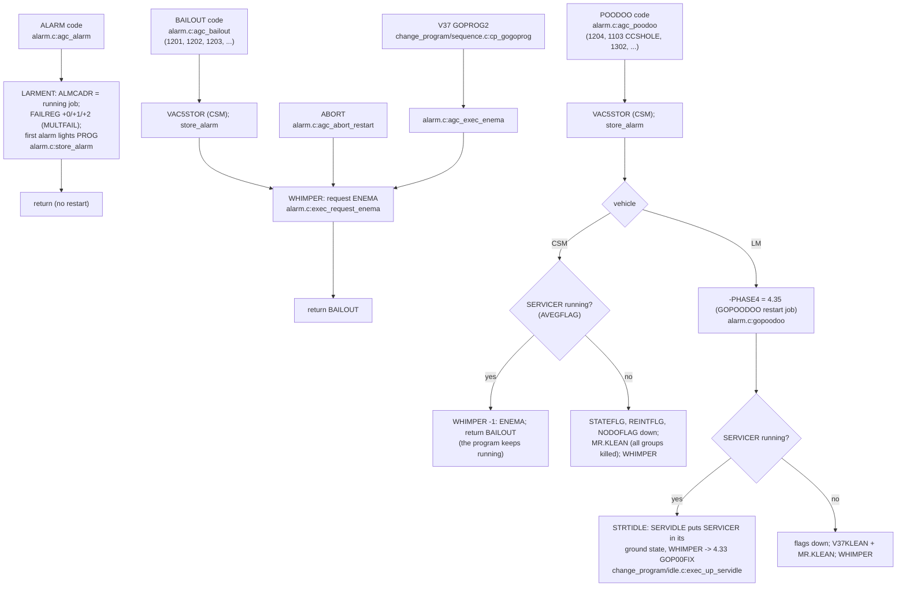
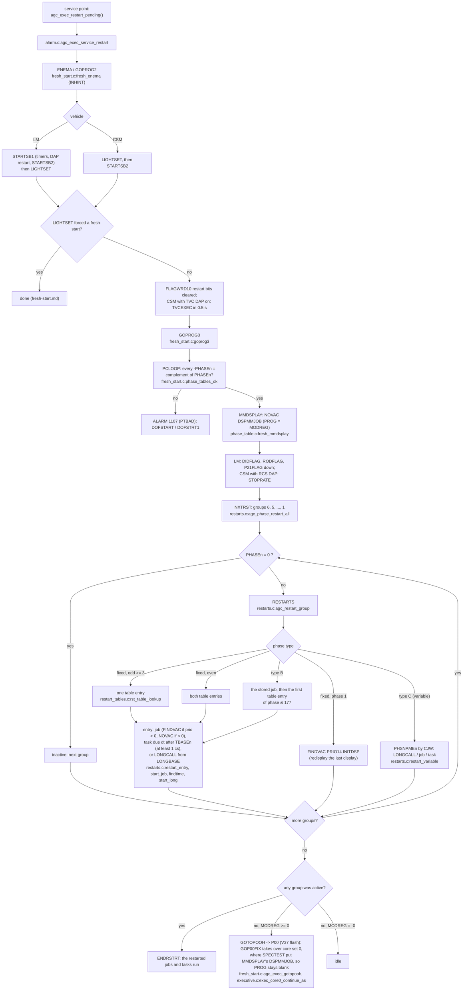

# Software restart (BAILOUT, POODOO, ENEMA) and the restart groups

AGC: ALARM_AND_ABORT.agc (C pp.1493-1496, L pp.1381-1385), FRESH_START_
AND_RESTART.agc (ENEMA, GOPROG2, GOPROG3, NXTRST, C pp.188-189 /
L pp.217-219), RESTARTS_ROUTINE.agc (C pp.1414-1419, L pp.1303-1308),
PHASE_TABLE_MAINTENANCE.agc. C: `src/exec/alarm.c`,
`src/exec/fresh_start.c`, `src/exec/restarts.c`,
`src/exec/phase_table.c`, `src/exec/restart_tables.c`.

In the AGC, BAILOUT and POODOO jump into ENEMA at once. In C that jump
would make the call graph recursive (rule 1), so the request is
recorded and served at the next **service point**: the end of the job
(`executive.c:agc_exec_run_one`), the end of T3RUPT
(`waitlist.c:agc_waitlist_t3rupt`), the exit of any interrupt
(`interrupts.c:rupt_exit`) or the harness loop (`sim/clock.c:clock_exec`,
`rupt_t3`). The function that raised it returns `AGC_STATUS_BAILOUT` /
`AGC_STATUS_POODOO` and every caller passes that up.

## Raising the restart

## Serving the restart

## Keeping the phase tables

* `agc_phase_change(code)` (PHASCHNG, phase_table.c) decodes the code
  word (`decode`: group, phase, type A/B/C, TBASE, priority) and stores
  -PHASEn and PHASEn together with interrupts inhibited
  (`phaschng_common`); a type B/C phase also stores the job or task to
  restart (`store_var`, `agc_phase_change_var`).
* `agc_phase_newphase` (NEWPHASE, CSM) is the quick fixed form,
  `agc_phase_change2` (2PHSCHNG) changes two groups at once.
* The KLEAN routines kill groups: `agc_phase_change_program_klean`
  (V37KLEAN: 3, 5, 6 and LM 1), `agc_phase_idle_klean` (P00KLEAN: 4, CSM
  also 1), `agc_phase_mr_klean` (MR.KLEAN: 2, then all).
* Deviation (phase_table.c `store_return_point`): a type A/B phase whose
  restart point is "the return address of PHASCHNG" restarts the job
  segment that made the phase change, the nearest point C can name.
