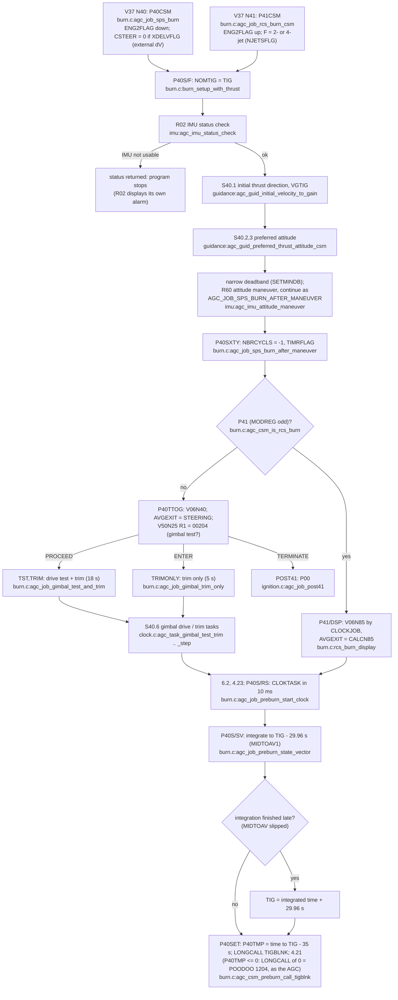
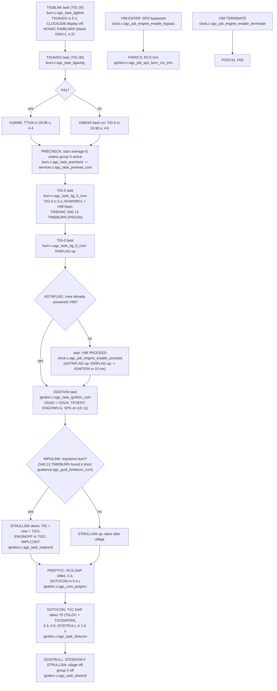
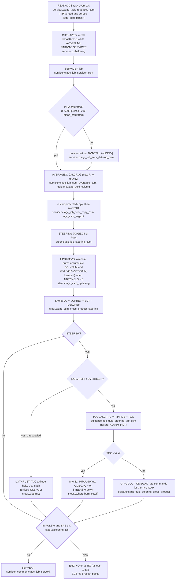
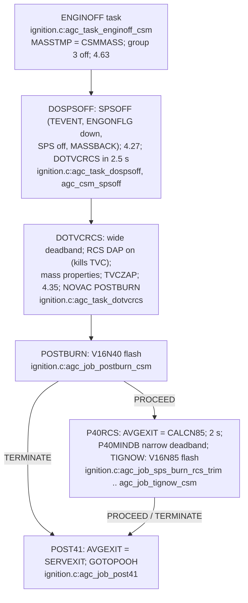

# CSM SPS burn (P40) and RCS burn (P41)

AGC: Comanche055 P40-P47.agc (pp.684-731): P40CSM, P41CSM, P40S/F,
P40SXTY, P40TTOG, TRIMONLY / TST,TRIM, P40S/RS, P40S/SV, TIGBLNK,
TIGAVEG, TIG-5, TIG-0, IGNITION, DOTVCON, DOSTRULL, STEERING, S40.8,
ENGINOFF, DOSPSOFF, DOTVCRCS, POSTBURN, CLOKTASK / CLOCKJOB, V99/V97;
SERVICER207.agc (READACCS, SERVICER, AVERAGEG). C:
`src/csm/burns/sps/{burn,ignition,clock,steer}.c`,
`src/csm/burns/servicer.c`, `src/guidance/*.c`.

The burn is a chain of jobs and waitlist tasks timed from TIG; each link
records its restart point in group 4 (pre-ignition sequence), 3, 5
(SERVICER) or 6 (CLOKTASK) so a restart resumes at the same step.

## Set-up to TIG - 30 s

## TIG - 35 s to ignition

## Powered flight: the 2-second cycle

## Cut-off and after

Engine-failure branch (R40, V97 flash raised by LOTHRUST through the
CLOCKJOB, `clock.c:cknvwrd1`): V97 TERMINATE shuts the SPS down and goes
to P00 (`agc_job_engine_fail_terminate` -> `agc_task_engine_fail_shutdown`
-> `agc_task_engine_fail_rcs_dap`); V97 PROCEED keeps burning with one
R40 bypass (`agc_job_engine_fail_proceed` -> `agc_task_engine_fail_resume`,
IDLEFAIL); V97 ENTER re-ignites (`agc_job_engine_fail_reignite` ->
`agc_task_engine_fail_reignite_prep` -> `agc_task_quickign` -> V99
flash).
