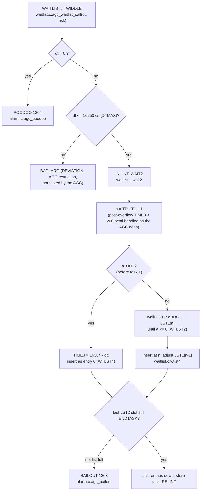
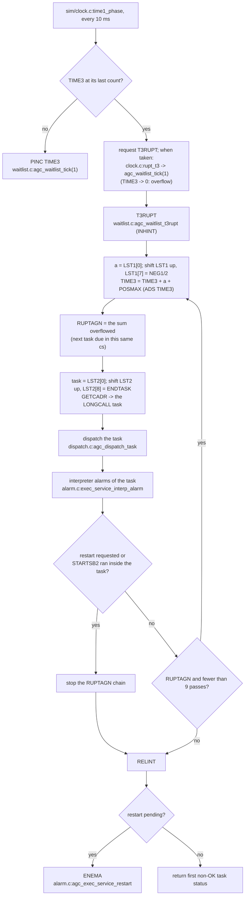

# Waitlist tick (TIME3, T3RUPT)

AGC: WAITLIST.agc (C pp.1221-1235, L pp.1117-1132): WAITLIST, WAIT2,
WTLST2/4/5, T3RUPT, T3RUPT2, TASKOVER, ENDTASK/SVCT3, LONGCALL. C:
`src/exec/waitlist.c`; the counter is driven by `src/sim/clock.c`.

The lists are the AGC's: TIME3 = 16384 - (T1 - T) counts up to the first
task; LST1 +0..+7 hold -(T(k+2) - T(k+1)) + 1, the deltas between the
next tasks; LST2 +0..+8 the task ids. An empty slot holds ENDTASK and
NEG1/2 (-8192), so with nothing scheduled ENDTASK runs every 81.93 s.

## Scheduling a task

`agc_waitlist_vardelay` / `agc_waitlist_fixdelay` are the same call made
from inside a task (they assert interrupts are inhibited);
`agc_waitlist_longcall` keeps one long delay in LONGTIME/LONGCADR and
re-schedules LONGCYCL every 81.92 s (`longcycl`) until the remainder fits,
then GETCADR runs the task. `agc_waitlist_kill` (LM KILLTASK) replaces
the first matching LST2 entry with TASKOVER.

## The tick and T3RUPT

ENDTASK (`agc_task_endtask` -> `svct3`): with DRIFTFLG set, start the IMU
drift-compensation job NBDONLY (NOVAC PRIO35) unless the IMU is in use
(IMUCADR non-zero), in which case retry in 5 s (`agc_task_svct3`).
